# SmartCampus AI — Night Agents

> Agentic, multilingual (French, Modern Standard Arabic, Tunisian Derja, Arabizi) and multimodal (text / voice) orientation and pre-registration platform for **IIT** and **ISB** — with **ISA** as an architectural extension — within the NAU Private University ecosystem in Sfax.

**"VISION talks, JARVIS follows up, humans decide."** Agents absorb conversational volume and scheduling logistics, deterministic code and rules bound what they may execute, and every academic recommendation is cited, measured, and signed off by a human decision-maker.

| Field | Detail |
| :--- | :--- |
| **Module** | Generative AI — 3rd Year Computer Engineering, Semester 1 (2026-2027) |
| **Project** | Projet N°3 — SmartCampus AI, Agentic University Orientation Platform |
| **Instructor** | M. Taoufik Ben Abdallah, in collaboration with VisioroAI |
| **Team** | Groupe 3 — Night Agents |
| **Members** | Mehdi Zouari (Lead) · Moataz Triki · Yassine Guermazi · Melek Rekik · Youssef Trabelsi |

---

## Platform Status (Sprint 1 + Sprint 2 Foundation)

The core full-stack platform, database isolation layer, local open-source AI integrations, official `iit.tn` corpus synchronizer, and empirical Colab Pro notebooks are implemented and covered by offline automated test suites:

- **Progressive Actor Lifecycle (`Visitor -> Candidate` + `NAU Responsable`):**
  - **`Visitor` (`VISITOR`):** Anonymous prospective students, university graduates, or parents/relatives inquiring on behalf of a candidate explore programs, check eligibility, and receive cited track recommendations with zero login wall (7-day sliding Redis session).
  - **`Candidate` (`CANDIDATE`):** Seamless Email/SMS OTP or Google OAuth sign-in automatically merges the anonymous Redis conversation and declared facts into PostgreSQL (`session_merged`, `turns_merged`), unlocking INPDP consent (`Law 2004-63`), official transcript upload (`1.4_Reader` VLM), pre-registration, targeted QCM, and interview booking.
  - **`NAU Responsable` (`RESPONSABLE`):** School-scoped (`iit | isb | isa`) portal (`/responsable`) consolidating candidate dossier review, 1-page interview briefs, availability slots, exclusive human-in-the-loop admission sign-off (`ADMITTED | WAITLIST | REJECTED`), and school-scoped academic catalog and RAG corpus administration.
  - **`Human RH` (Operational Support):** Handles escalated scheduling or document discrepancy tickets (`owner in {JARVIS, RH:<user>}`) without admission sign-off authority. Standalone `Direction` and `Platform Admin` UI actors are retired (retained strictly as legacy SQL/RLS and root `/catalog/schools` compatibility roles).
- **100% Local Open-Source AI Stack (`<= 9B` Parameters, Keyless):** Powered locally via Ollama (`qwen3:8b` with `/no_think` fast mode, `qwen2.5:7b-instruct`, single QLoRA adapter `smartcampus-vision-8b`, `qwen2.5vl:7b` VLM, `BAAI/bge-m3` `1024d` embeddings), `BAAI/bge-reranker-v2-m3`, and local `whisper-large-v3` STT (`WHISPER_PROVIDER=local`) with deterministic offline CI fallbacks.
- **Official Web Corpus (`https://iit.tn/`):** 42 scraped verbatim official IIT Markdown pages + `manifest.json` in `backend/data/corpus/iit/`, synchronized idempotently into PostgreSQL (`core.documents`, `core.document_versions`, `core.document_sync_jobs`) via SHA-256 change detection (`backend/scripts/sync_iit_corpus.py`).
- **PostgreSQL 16 + `pgvector` Isolation:** 5 schemas (`core`, `iit`, `isb`, `isa`, `knowledge`), 40 tables, 79 foreign keys, Row-Level Security (RLS), and `knowledge.chunks.embedding vector(1024)` HNSW cosine indexing (Alembic revision `20261127_0003`).

---

## End-to-End Orientation & Admission Pipeline

```mermaid
flowchart LR
    subgraph P1["1. Discover (Visitor - Anonymous)"]
        S1["1. Talk (Text / Voice)"] --> S2["2. Ask & Build Profile (RAG)"] --> S3["3. Check Eligibility"] --> S4["4. Recommend 2-3 Tracks"]
    end
    subgraph P2["2. Enrol (Candidate - Authenticated)"]
        S5["5. OTP / OAuth + Auto-Merge"] --> S6["6. Pre-Registration & VLM Transcript"] --> S7["7. Short QCM + 1-Page Brief"]
    end
    subgraph P3["3. Follow Up (JARVIS / Human RH)"]
        S8["8. Book · Remind · Reschedule (max 2) · Escalate"]
    end
    subgraph P4["4. Decide (NAU Responsable HITL)"]
        S9["9. Interview & Signed Human Decision"]
    end
    S4 --> S5
    S7 -- "core.outbox: pre-inscription submitted" --> S8
    S8 --> S9
```



### Multi-Agent & Human Governance Matrix

| Unit | Type | Role | Pipeline Scope |
| :--- | :--- | :--- | :--- |
| **VISION** | LangGraph `StateGraph` supervisor | Plans conversational routing across `1.1_Listener` (STT + dialect/Arabizi NLU), `1.2_Librarian` (cited RAG + catalog tools), `1.3_Gatekeeper` (profile + YAML eligibility rules), `1.4_Reader` (VLM transcript extraction), `1.5_Advisor` (`score_compatibilite()` + 2-3 tracks), and `1.6_Registrar` (pre-fill, QCM, 1-page brief, `core.outbox`) | Steps 1–7 |
| **JARVIS** | Event & Celery timer workers | Stateless back-office orchestrator (`2.1_Scheduler` SQL `SELECT ... FOR UPDATE`, `2.2_Messenger` template-bound notifications, `2.3_Fixer` waitlist & `rh_ticket` escalation); never called directly by VISION | Step 8 |
| **Guardrail Node** | Rules + RAG grounding | Blocks prompt injection and out-of-corpus traps, enforces source citations, masks PII, aligns output language/dialect, and blocks any admission promise (`FORBIDDEN_AGENT_STATUSES`) | Cross-cutting |
| **Human RH** | Human support actor | Claims escalated `rh_ticket` cases (72h silence, no-show, 3rd reschedule, `MISMATCH_RH`); immediately pauses automated JARVIS messages (`One Owner` rule) | Step 8 |
| **NAU Responsable** | Human decision-maker | Manages school catalog and RAG corpus (`iit | isb | isa`), publishes interview slots, reviews the 1-page brief, and signs the official decision (`ADMITTED | WAITLIST | REJECTED`) | Step 9 + Corpus/Catalog |

---

## Local Open-Source AI & RAG Stack (`<= 9B`)

| Layer | Active Local Model / Engine | Runtime & Configuration | Notes |
| :--- | :--- | :--- | :--- |
| **VISION LLM** | `qwen3:8b` (`/no_think`) or `smartcampus-vision-8b` (QLoRA Q4_K_M GGUF) | Local Ollama (`LLM_PROVIDER=ollama`, keyless) | Co-finalist `qwen2.5:7b-instruct`; benchmarked alongside `gemma2:9b` and `aya-expanse:8b` (`0-Shot -> Few-Shot -> QLoRA`) |
| **JARVIS LLM** | `qwen2.5:7b-instruct` (fallback `qwen3:8b` `/no_think`) | Local Ollama (`http://host.docker.internal:11434/v1`) | Template-bounded reminder personalization and candidate reply classification |
| **Transcript VLM (`1.4_Reader`)** | `qwen2.5vl:7b` | Local Ollama (`VLM_PROVIDER=ollama`, keyless) | Extracts Tunisian Bac and Licence transcripts with weighted average verification and `< 0.85` field confidence flags |
| **Embeddings & Reranker (`1.2_Librarian`)** | `BAAI/bge-m3` (`1024d`) + `BAAI/bge-reranker-v2-m3` | Local Ollama (`EMBEDDING_MODEL=bge-m3`) + Python cross-encoder | Progressive RAG: Dense `pgvector` (`vector(1024)` HNSW) -> Hybrid `pgvector` + `TSVECTOR` RRF -> Cross-encoder reranking + CRAG gating -> SQL catalog + YAML rules |
| **Speech-to-Text (`1.1_Listener`)** | `whisper-large-v3` (`faster-whisper`) | `WHISPER_PROVIDER=local` (`WHISPER_BASE_URL`) | Multilingual FR / Derja / Fusha audio transcription with mandatory user review before invoking VISION |

---

## Core Engineering Principles

- **Give or Keep Authentication:** Orientation and cited program Q&A require no account; authentication is requested only before uploading official transcripts, saving/emailing a shortlist, or submitting pre-registration.
- **Zero Hallucinated Program Facts:** Tuition fees, admission deadlines, thresholds, and curricula are served strictly from PostgreSQL catalog tables and cited `knowledge.chunks` passages — never fabricated from model weights. Unverified seed placeholders are explicitly tagged `TODO(corpus)`.
- **Single Case Owner:** Every candidate dossier has a single active owner (`JARVIS` or `RH:<user>`); human takeover immediately halts automated follow-ups.
- **Humans Decide Admissions:** No AI agent, graph node, or tool can write `ADMITTED`, `WAITLIST`, or `REJECTED`.

---

## Repository Layout

```text
.
├── architecture/                     # System architecture, DB schemas, RBAC, API contracts & evaluation specs
├── backend/                          # FastAPI async backend (Python 3.12, SQLAlchemy 2, LangGraph, Alembic)
│   ├── alembic/versions/             # Migrations 0001 (schema), 0002 (RLS), 0003 (bge-m3 1024d & actor constraints)
│   ├── app/                          # API v1 routers, Pydantic v2 schemas, ORM models & VISION/RAG/VLM services
│   ├── data/corpus/iit/              # 42 scraped official https://iit.tn/ Markdown documents + manifest.json
│   ├── scripts/                      # scrape_iit_tn.py, sync_iit_corpus.py, seed_db.py, verify_schema.py, benchmarks
│   └── tests/                        # Offline pytest suite + 70-question SA-32 & 15-case SA-34 evaluation datasets
├── docker/postgres/                  # PostgreSQL 16 + pgvector initialization (5 schemas & RLS roles)
├── frontend/                         # Next.js 16 / React 19 / TypeScript workspace (/ and /responsable)
├── ml/colab/                         # 3 Google Colab Pro notebooks (0-Shot -> Few-Shot -> QLoRA, VLM & Whisper)
│   ├── 01_zero_shot_few_shot_rag_benchmark.ipynb
│   ├── 02_qwen_qlora_finetune_gguf_ollama.ipynb
│   ├── 03_vlm_ocr_whisper_benchmark.ipynb
│   └── Modelfile.smartcampus-vision-8b
├── docker-compose.yml                # Local orchestration (PostgreSQL 16 + pgvector, Redis 7, FastAPI, Next.js)
└── .env.example                      # Keyless local Ollama, bge-m3 1024d & local Whisper configuration template
```

---

## Quickstart (Docker Compose & Local Ollama)

### 1. Pull Local Open-Source Models (`<= 9B`) on Host Ollama

```bash
ollama pull qwen3:8b
ollama pull qwen2.5:7b-instruct
ollama pull qwen2.5vl:7b
ollama pull bge-m3
```

### 2. Start Infrastructure, Backend & Frontend

```bash
cp .env.example .env
docker compose up -d --build
```

- **Visitor / Candidate Web Workspace:** `http://localhost:3000`
- **NAU Responsable Portal (Dossiers, HITL Decisions, School Catalog & RAG Corpus):** `http://localhost:3000/responsable`
- **FastAPI OpenAPI / Swagger UI:** `http://localhost:8000/docs`

### 3. Migrate, Seed & Synchronize the 42-Document Official `iit.tn` Corpus

```bash
docker compose exec -T backend sh -c "alembic upgrade head && python scripts/seed_db.py && python scripts/sync_iit_corpus.py && python scripts/verify_schema.py"
```

### 4. Run Offline Quality Gates (Lint, Type-Check & Tests)

```bash
# Backend Ruff lint + offline pytest suite (zero external API keys required)
docker compose exec -T backend sh -c "ruff check . && pytest -q"

# Frontend ESLint + TypeScript strict verification
docker compose exec -T frontend sh -c "npm run lint && npx tsc --noEmit"
```
