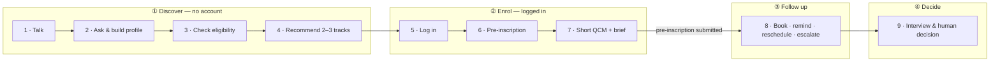

# SmartCampus AI — Night Agents

> Agentic, multilingual (French · Tunisian Derja · Arabizi) and multimodal (text / voice)
> orientation & admission platform for **IIT** and **ISB** — with **ISA** as an announced
> extension — within the NAU ecosystem.

**"VISION talks, JARVIS follows up, humans decide."** Agents handle the volume, rules
bound what they may do, and every recommendation is cited, measured and signed off by a
person.

| | |
| :-- | :-- |
| **Module** | IA Générative — 3ème année Génie Informatique · Semestre 1 · 2026/2027 |
| **Project** | Projet N°3 — SmartCampus AI, plateforme agentique d'orientation universitaire |
| **Teacher** | M. Taoufik Ben Abdallah · in collaboration with VisioroAI |
| **Team** | Groupe 3 — « Night Agents » |
| **Members** | Mehdi Zouari (Lead) · Moataz Triki · Yassine Guermazi · Melek Rekik · Youssef Trabelsi |

## Status

🚧 **Design phase.** The architecture (v3) is defined; no application code yet.

## What it does

A future student chats with the platform by text or voice, asks free questions about
programs, gets a justified shortlist of 2–3 tracks, pre-registers, takes a short targeted
QCM, and is followed up until the interview, where a human makes the final decision.



| Agent | Role | Steps |
| :-- | :-- | :-- |
| **VISION** | Front-office supervisor (LangGraph): 1.1 Listener · 1.2 Librarian · 1.3 Gatekeeper · 1.4 Reader · 1.5 Advisor · 1.6 Registrar | 1–7 |
| **JARVIS** | Back-office, event + timer driven: 2.1 Scheduler · 2.2 Messenger · 2.3 Fixer | 8 |
| **Human RH** | Owns exceptions (no reply 72 h, no-show, 3rd change, complaints) | 8 |
| **NAU Responsable** | Interviews and signs the decision: admitted / waitlist / rejected | 9 |
| ATLAS *(optional)* | Direction insights — natural-language questions over read-only data | — |

## Planned stack

Next.js / React · FastAPI · PostgreSQL 16 + pgvector · Redis · Celery · MinIO ·
Whisper · LangGraph · open-source 7–8B LLM + QLoRA (Derja / Arabizi adapter) ·
VLM for transcript extraction · SMTP / SMS + calendar API · Langfuse / LangSmith.

## Core principles

- 🔒 **Login only when needed** — chat and orientation are anonymous; an account is
  required only to upload documents, save the shortlist or pre-register.
- 📚 **No invented answers** — every program fact comes from official documents and is
  shown with its source.
- 🧑‍💼 **Agent + human, one owner** — JARVIS handles normal cases; the Human RH takes
  over exceptions and the agent stops.
- ✅ **Humans decide** — only the NAU Responsable admits, waitlists or rejects.

## Repository layout

```text
.
├── AGENTS.md                         # Always-on rules for AI coding agents
├── .agents/skills/smartcampus-project/
│   ├── SKILL.md                      # Project context & anti-hallucination rules
│   └── references/                   # Spec summary, architecture, data model,
│                                     # evaluation & roadmap, open questions
└── README.md
```

> [!NOTE]
> The `Docs/` folder (official spec and team architecture PDFs) is kept locally and is
> not versioned.

## Working with AI coding agents

This repo ships an agent setup to keep assistants focused on the project:
[`AGENTS.md`](./AGENTS.md) is loaded automatically and requires reading the
[`smartcampus-project`](./.agents/skills/smartcampus-project/SKILL.md) skill before any
task. Open points still to decide are tracked in
[`open_questions.md`](./.agents/skills/smartcampus-project/references/open_questions.md).