# SmartCampus AI — Acteurs, Processus Métiers & Règles HITL (`SA-3`)

> **Tâche :** `[SA-3]` Définir les acteurs et les processus métiers (Issue GitHub `#7` · Epic `SA-1: Architecture & Setup`)  
> **Responsable :** Moataz Triki (`MT` / `@moatazz12`)

---

## 1. Synthèse de la gouvernance (« Human-in-the-Loop »)

> **"VISION talks, JARVIS follows up, humans decide."**  
> Les agents traitent le volume conversationnel et la coordination ; le code déterministe et les règles YAML encadrent strictement leur périmètre d'action ; chaque information sur les formations est sourcée via le corpus RAG ou la base de données, et **seul un responsable humain décide de l'admission officielle**.

### Frontières non négociables (HITL & maîtrise des agents)

| Catégorie | Ce qui est autorisé | Ce qui est strictement interdit |
| :--- | :--- | :--- |
| **Décision d'admission** | **`NAU Responsable`** signe manuellement `ADMITTED \| WAITLIST \| REJECTED`. | Aucun agent (`VISION`, `JARVIS`, `ATLAS`) ni aucun outil ne peut admettre, mettre en liste d'attente, refuser ou promettre une admission. |
| **Données & Règles** | Faits académiques servis uniquement via RAG (`knowledge`) avec citation obligatoire des sources ; frais, prérequis, seuils, campagnes et documents officiels administrés par le **`Responsable`** (cloisonné par école `iit \| isb \| isa`). | Génération libre de frais de scolarité, dates limites, seuils ou contenus de programmes non présents dans le corpus officiel indexé. |
| **Règle d'accès (« Give or Keep »)** | Orientation et échange 100 % anonymes en tant que **`Visiteur`** dès le premier message (lycéen, étudiant ou parent/proche) ; passage en **`Candidat`** par authentification OTP/OAuth avec fusion automatique de session exigé uniquement avant le dépôt d'un document officiel, la sauvegarde persistante d'une shortlist ou la préinscription. | Mur de connexion dès l'ouverture du chat, ou stockage d'un relevé de notes officiel sous session anonyme. |
| **Séparation Front / Back** | `VISION` écrit un événement `pre-inscription submitted` dans `core.outbox` ; `JARVIS` réagit uniquement de façon événementielle et sur timers. | `VISION` et `JARVIS` ne s'appellent **jamais** directement. Les utilisateurs humains ne dialoguent jamais directement avec les sous-agents internes (`1.1–1.6`, `2.1–2.3`). |
| **Propriété des dossiers (`One Owner`)** | `candidate.owner` / `rh_ticket.owner` ∈ `{JARVIS, RH:<user>}`. La reprise d'un dossier par `Human RH` suspend immédiatement toute relance automatique. | Envoi parallèle de messages contradictoires par `JARVIS` et par un agent humain. |

---

## 2. Typologie complète des acteurs

À la suite de la revue d'évaluation académique, le modèle d'acteurs a été simplifié et clarifié autour d'un cycle de vie continu **`Visiteur` -> `Candidat`** côté demandeur (couvrant lycéens, étudiants universitaires ou parents/proches se renseignant pour un candidat) et du rôle consolidé **`Responsable`** côté école, assisté en back-office par `Human RH` pour les exceptions opérationnelles. Les rôles historiques `Direction` et `Platform Admin` sont retirés du périmètre d'acteurs primaires (leurs codes restent uniquement tolérés en base pour la rétrocompatibilité des migrations SQL).

### 2.1 Acteurs primaires humains (initient les cas d'utilisation)

| Acteur UML / Métier | Stade & Profils couverts | Rôle & responsabilités | Cas d'utilisation associés |
| :--- | :--- | :--- | :--- |
| **1. `Visiteur`** *(avant authentification)* | **Stade `VISITOR`** (`ANONYMOUS` -> `PROFILING` -> `ELIGIBLE \| INELIGIBLE` -> `ORIENTED`) | Lycéen, étudiant ou parent/proche découvrant sans compte les formations IIT / ISB *(avec ISA en extension au sein de NAU)* par texte ou voix (FR, Fusha, Derja tunisienne, Arabizi) ; pose des questions libres (RAG) ; déclare son niveau et ses notes pour vérifier son éligibilité ou une passerelle/équivalence ; reçoit une shortlist justifiée de 2 à 3 parcours. Mémoire chaude Redis glissante (TTL 7 jours). | `UC01` Ask about programs · `UC02` Get track recommendation · `UC03` Check eligibility (`«include»`) · `UC06` Create an account (`«extend»`) |
| **2. `Candidat`** *(après authentification)* | **Stade `CANDIDATE`** (`AUTHENTICATED` -> `PREINSCRIBED` -> `QCM_DONE` -> `SCHEDULED` -> `INTERVIEWED` -> `ADMITTED \| WAITLIST \| REJECTED`) | `Visiteur` promu `Candidat` après authentification OTP (email/téléphone) ou Google OAuth avec **fusion automatique** de sa session anonyme (`actor_stage = "CANDIDATE"`, `session_merged = true`) ; valide son consentement explicite (Loi organique n° 2004-63 / INPDP) ; dépose son relevé officiel pour extraction VLM (`1.4_Reader`) et pré-remplissage du dossier ; passe le QCM ciblé ; réserve ou replanifie son entretien (max 2 modifications) et suit l'avancement. | `UC04` Submit pre-registration (`«include» UC05`) · `UC05` Log in & auto-merge session · `UC07` Take QCM test · `UC08` Manage interview appointment · `UC09` Track application & notifications |
| **3. `Responsable`** *(par école : IIT · ISB · ISA)* | **Stade `RESPONSABLE`** *(Responsable académique, suivi dossiers & mise à jour BD/corpus)* | **Mise à jour & suivi BD / RAG :** gère les programmes, prérequis, frais officiels, campagnes d'admission et documents du corpus RAG de son établissement (`school_scope`). **Entretiens & décisions HITL :** publie ses créneaux de disponibilité, consulte le dossier complet, les résultats QCM et le brief 1 page, conduit l'entretien et **signe la décision officielle d'admission** (`ADMITTED \| WAITLIST \| REJECTED`). | `UC12` View admissions dashboard · `UC13` Publish interview availability · `UC14` Evaluate candidate & decide admission · Gestion catalogue & corpus RAG (`school_scope`) |

### 2.2 Support opérationnel & compatibilité historique

* **`Human RH` (support exceptions) :** intervient sur les escalades `JARVIS` (`rh_ticket` : 72h sans réponse, `NO_SHOW`, 3e report, anomalie `declared != official` sur relevé VLM) avec règle du propriétaire unique (`owner = RH:<user>`). Ne signe jamais de décision d'admission.
* **Retrait de `Direction` et `Platform Admin` des acteurs primaires :** les interfaces dédiées `Direction` et `Admin` sont retirées au profit du portail unifié **`Responsable`** (qui porte la mise à jour du catalogue et du corpus RAG de son école ainsi que le suivi des dossiers et KPIs). Les contraintes SQL et routes de registre racine conservent une compatibilité ascendante technique afin de ne pas casser les migrations existantes.

### 2.3 Acteurs secondaires système — Architecture Multi-Agents

Les agents interviennent en tant qu'**acteurs secondaires (`«agent»`)** : ils exécutent les traitements déclenchés par les acteurs humains ou par les événements et temporisations autorisés. Chaque composant est explicitement typé (**LLM / VLM / règles / code déterministe**).

| Orchestrateur | Sous-agent / Nœud | Type technique | Rôle exact |
| :--- | :--- | :--- | :--- |
| **`VISION`** *(LangGraph Supervisor · Front-office, Étapes 1–6 + Sign-up)* | `1.1 Listener` | **LLM** (+ Whisper STT local sans clé, LID, normaliseur Arabizi) | Transcrit l'audio, normalise Derja/Arabizi, détecte l'intention et la langue. |
| | `1.2 Librarian` | **LLM+RAG** (`pgvector` `bge-m3` `1024d` + `TSVECTOR` RRF + reranker) | Répond en continu sur le corpus officiel IIT / ISB / ISA (dont les 42 pages `https://iit.tn/` dans `backend/data/corpus/iit/`) avec citations obligatoires des sources. |
| | `1.3 Gatekeeper` | **LLM + Règles YAML** | Extrait les faits déclarés (`candidate_profile`) et évalue l'éligibilité, les prérequis et les passerelles/équivalences de manière déterministe. |
| | `1.4 Reader` | **VLM** (`qwen2.5vl:7b` local Ollama + `pypdf` / Pillow) | Extrait les matières, notes et moyennes du relevé officiel après authentification, avec score de confiance par champ. |
| | `1.5 Advisor` | **Code + LLM** | Calcule `score_compatibilite()` (critères académiques et intérêts uniquement, sans biais) et justifie 2 à 3 parcours. |
| | `1.6 Registrar` | **LLM** | Pré-remplit le formulaire cible, génère le QCM (5–10 questions) depuis la banque approuvée, rédige le brief 1 page et émet l'événement `outbox`. |
| **`JARVIS`** *(Event / Timer Workers · Back-office, Étape 7)* | `2.1 Scheduler` | **Code déterministe** | Gère les créneaux (`FREE / HELD / BOOKED`), interdit tout double-booking (`unique(responsable_id, start_time)` + `SELECT ... FOR UPDATE`), gère automatiquement la liste d'attente (blocage temporaire 15 min aux 3 candidats suivants). |
| | `2.2 Messenger` | **LLM** (borné par templates RH) | Personnalise les relances (T-24h, 24h, 48h), interprète les réponses (confirmer / déplacer / annuler) et notifie la décision humaine signée. |
| | `2.3 Fixer` | **Règles + LLM** | Libère les créneaux annulés, applique le plafond `reschedules <= 2` et ouvre les tickets `rh_ticket` (résumé 5 lignes + historique chronologique). |
| **Transversal** | **Guardrail Node** | **Règles + Ancrage RAG** | Contrôle chaque sortie : présence de citation pour tout fait académique, aucune promesse d'admission, aucun frais ou délai inventé, protection contre l'injection de prompt et masquage PII dans les journaux. |
| **Optionnel (*stretch*)** | **`ATLAS`** | **LLM** | Traduit des questions analytiques du `Responsable` en requêtes SQL en lecture seule sur les vues statistiques agrégées. |

---

## 3. Processus métiers détaillés (8 étapes + inscription parallèle)

Le pipeline à **8 étapes séquentielles et inscription parallèle** couvre l'ensemble du cycle de vie, de la première prise de contact anonyme jusqu'à la notification de la décision humaine, en structurant les **4 processus métiers clés** :

```mermaid
flowchart LR
    subgraph P1["Phase 1 - DISCOVER (Visiteur sans compte · Redis TTL 7j)"]
        S1["1. Talk (Texte / Audio FR - Derja - Arabizi)"] --> S2["2. Ask & Build Profile (RAG + Faits déclarés)"]
        S2 --> S3["3. Check Eligibility & Equivalence (Règles YAML)"]
        S3 --> S4["4. Recommend 2-3 Tracks (Shortlist justifiée)"]
    end

    SP["Parallel Sign-Up 'Give or Keep' (Visiteur -> Candidat : OTP / OAuth + Auto-merge + Consentement INPDP)"]
    S1 -. "Optionnel" .-> SP
    S4 -- "Obligatoire avant dépôt relevé" --> SP

    subgraph P2["Phase 2 - ENROL (Candidat identifié · PostgreSQL + Stockage objet)"]
        S5["5. Préinscription (Upload relevé VLM + Formulaire + Routage core/école)"] --> S6["6. Short QCM (5-10 q.) + Brief 1 page"]
    end

    SP --> S5

    subgraph P3["Phase 3 - FOLLOW UP (JARVIS & Support RH)"]
        S7["7. Book, Remind & Reschedule (max 2) · Escalade si exception"]
    end

    S6 -- "Outbox: pre-inscription submitted" --> S7

    subgraph P4["Phase 4 - DECIDE & MAINTAIN BD (Responsable HITL)"]
        S8["8. Entretien, Décision signée & Mise à jour BD/RAG (Responsable) -> Notification"]
    end

    S7 --> S8
```



### 3.1 Processus 1 : Demandes d'équivalence, d'éligibilité & orientation (`Étapes 1–4`)

* **Acteurs :** `Visiteur` *(lycéen, étudiant ou parent/proche sans compte)*, `VISION` (`1.1 Listener`, `1.2 Librarian`, `1.3 Gatekeeper`, `1.5 Advisor`).
* **Déroulement :**
  1. **Accueil multimodal (Étape 1) :** le visiteur saisit un message texte ou envoie un audio (transcrit via Whisper STT). `1.1 Listener` identifie la langue (FR / Derja / Arabizi), normalise l'Arabizi et détecte l'intention.
  2. **Information programmes & passerelles en continu (Étape 2) :** à tout instant, `1.2 Librarian` interroge `knowledge` (`pgvector` `bge-m3` `1024d` + `TSVECTOR` RRF + reranker) pour renseigner le visiteur sur les filières (IIT Licence / Prépa / Ingénierie, ISB, extension ISA) et les passerelles/équivalences, avec **citation exacte** de la source (ou refus explicite avec contact humain si la demande sort du corpus). Les éléments scolaires déclarés (diplôme actuel : Bac / Licence / Prépa, moyenne déclarée, spécialité, intérêts) alimentent progressivement `candidate_profile`.
  3. **Traitement des demandes d'éligibilité & équivalence (Étape 3) :** `1.3 Gatekeeper` applique le moteur de règles YAML (alimenté par les grilles officielles configurées par le `Responsable`) pour évaluer l'accès direct ou par équivalence/passerelle :
     * **Éligible (`ELIGIBLE`)** -> poursuite vers le calcul de recommandation.
     * **Cas limite / équivalence particulière** -> marquage `"à confirmer par le Responsable"` afin de garantir une vérification humaine sans rejet abusif ni promesse d'admission.
     * **Non éligible (`INELIGIBLE`)** -> arrêt précoce avant tout traitement coûteux (VLM/QCM) et présentation des alternatives ou passerelles existantes.
  4. **Recommandation justifiée (Étape 4) :** `1.5 Advisor` calcule `score_compatibilite()` (exclusivement à partir des critères académiques et intérêts déclarés) et restitue **2 à 3 parcours côte à côte** avec décomposition du score, points forts, prérequis et références sourcées. Le visiteur conserve son libre choix (`ORIENTED`).

### 3.2 Processus 2 : Authentification (`Visiteur -> Candidat`) & Préinscription (`Sign-up + Étapes 5–6`)

* **Acteurs :** `Visiteur -> Candidat` *(après authentification)*, `VISION` (`1.4 Reader`, `1.6 Registrar`), `Responsable` / `Human RH` *(si anomalie documentaire)*.
* **Déroulement :**
  1. **Authentification progressive (« Give or Keep ») :** facultative durant les étapes 1 à 4 (*« Sauvegarder ma progression »* ou *« Recevoir ma shortlist par email »*), **obligatoire juste avant le dépôt du relevé de notes** (`UC04 «include» UC05`). Inscription rapide sans formulaire lourd : code OTP (email/téléphone) ou Google OAuth + **validation d'un consentement explicite** journalisé dans `consent` (Loi organique n° 2004-63 / INPDP).
  2. **Fusion automatique de session :** lors de `POST /api/v1/auth/otp/verify` ou `POST /api/v1/auth/oauth/google`, le backend détecte automatiquement la session invité (champ `anonymous_session_id`, cookie signé `smartcampus_guest_session` ou en-tête `X-Session-ID`), fusionne le profil déclaré et l'historique Redis vers PostgreSQL (`core.candidate`, `core.candidate_profile`, `core.shortlist`), efface le cookie invité et retourne `actor_stage = "CANDIDATE"`, `session_merged = true` et `turns_merged`.
  3. **Dépôt relevé & extraction VLM (Étape 5) :** le relevé officiel est stocké chiffré (`core.document`). `1.4 Reader` (VLM local `qwen2.5vl:7b`) extrait les matières, notes et moyennes avec un indice de confiance par champ. `1.6 Registrar` pré-remplit le formulaire spécifique à l'école visée et met en évidence les champs incertains pour validation manuelle par le candidat.
  4. **Contrôle de cohérence & routage transactionnel :**
     * En cas d'écart significatif persistant entre notes déclarées et relevé officiel après relecture du candidat -> ouverture d'un ticket `rh_ticket` pour contrôle humain (`UC10`).
     * Lors de la validation finale -> écriture **atomique (transaction unique)** dans `core` et dans le schéma de l'école cible (`iit`, `isb` ou `isa`) sous isolation RLS, passage à `PREINSCRIBED` et émission d'un événement `pre-inscription submitted` dans `core.outbox`.
  5. **QCM ciblé & Brief d'entretien (Étape 6) :** `1.6 Registrar` sélectionne **5 à 10 questions** dans la banque approuvée par le `Responsable`, évalue automatiquement les réponses et génère un **brief synthétique d'1 page** pour l'évaluateur (`QCM_DONE`).

### 3.3 Processus 3 : Prise de rendez-vous, Relances & Escalade RH (`Étape 7`)

* **Acteurs :** `Candidat` *(`CANDIDATE`, authentifié)*, `JARVIS` (`2.1 Scheduler`, `2.2 Messenger`, `2.3 Fixer`), `Human RH`, `NAU Responsable` *(publication des créneaux `UC13`)*.
* **Machine à états des rendez-vous :**

```text
AWAITING_SLOT --> INVITED --> BOOKED --> REMINDED --> ATTENDED --> (Étape 8 : Décision)
                     |          |            |
          (72h sans  |          | (cancel    | (absent jour J)
           réponse)  |          |  ou report)|
                     |          v            v
                     |      CANCELLED     NO_SHOW ----+
                     |    (slot libéré ;              |
                     |     réallocation <= 2)         |
                     |          |                     |
                     |   (si report > 2)              |
                     v          v                     v
                 ESCALATED <--------------------------+  (owner = Human RH)
                     |
          (clôturé)  v
                 WITHDRAWN
```

* **Matrice d'escalade et bornes d'autorité (`JARVIS` vs `Human RH`) :**

| Situation | Action autorisée de `JARVIS` | Escalade vers `Human RH` (`rh_ticket` + arrêt auto) |
| :--- | :--- | :--- |
| Préinscription démarrée non soumise | Relances à 48h et 7 jours | Jamais (nettoyage automatique en fin de campagne) |
| Invitation sans réponse | Relances à 24h et 48h | **À 72h sans réponse** -> statut `DORMANT` + ticket RH |
| Demande de report ou d'annulation | Propose d'autres créneaux ; libère le créneau annulé (blocage temporaire 15 min pour les 3 candidats suivants en liste d'attente) | **À la 3ème modification** (`reschedules > 2`) |
| Absence le jour de l'entretien | Enregistre `NO_SHOW` | **Immédiat** — reprise manuelle par appel humain |
| Annulation par `NAU Responsable` | Transmet les excuses et propose des créneaux prioritaires | **Si aucun créneau disponible sous 7 jours** |
| Anomalie relevé / réclamation / exception frais ou délai | Accuse réception de façon neutre, sans aucun engagement | **Immédiat** (discordance confirmée ou toute demande d'exception) |

* **Garantie d'idempotence :** clé unique `appointment_id + message_type` couplée à un balayage périodique toutes les 10 minutes afin d'éviter toute relance manquée ou envoyée en double.

### 3.4 Processus 4 : Entretien & Décision finale HITL (`Étape 8`)

* **Acteurs :** `NAU Responsable` *(décideur unique)*, `Candidat` *(`CANDIDATE`, destinataire)*, `JARVIS` *(messager uniquement après validation humaine)*.
* **Déroulement :**
  1. En amont de l'entretien, `NAU Responsable` consulte depuis son portail le **brief 1 page**, les scores QCM, l'historique d'orientation et les éventuelles alertes d'équivalence ou d'anomalie (`UC14`).
  2. Il mène l'entretien (`INTERVIEWED`) puis **saisit et signe manuellement la décision officielle** accompagnée de ses observations : **`ADMITTED`**, **`WAITLIST`** ou **`REJECTED`**.
  3. Dès enregistrement de cette signature humaine, `JARVIS` adresse la notification validée (email et portail candidat), archive l'historique du dossier et applique la politique de rétention des données.

---

## 4. Machine à états complète du candidat

Une colonne unique `candidate.status` assure le suivi cohérent de l'avancement du dossier sur l'ensemble des portails et workflows :

```text
ANONYMOUS --> PROFILING --> ELIGIBLE | INELIGIBLE --> ORIENTED --> AUTHENTICATED
   --> PREINSCRIBED --> QCM_DONE --> SCHEDULED --> INTERVIEWED --> ADMITTED | WAITLIST | REJECTED

États transversaux : DORMANT · ESCALATED · WITHDRAWN
```

---

## 5. Paramètres d'intégration et règles de configuration

* **Référentiel académique et règles d'éligibilité :** les catalogues détaillés de formations, les grilles et seuils d'équivalence/éligibilité (YAML), les frais de scolarité, le corpus RAG ainsi que les dates de campagne sont administrés par le **`Responsable`** (cloisonné par école `iit \| isb \| isa`) à partir des documents officiels validés ; aucune valeur variable n'est figée dans le code ou les prompts des agents.
* **Extension multi-écoles (ISA) :** le socle cible prioritairement **IIT** et **ISB**, tout en prévoyant dès l'architecture le routage transactionnel, le schéma PostgreSQL dédié (`isa`) et l'isolation RLS pour l'activation d'**ISA** au sein de l'écosystème NAU.
* **Granularité RBAC du rôle Responsable :** le rôle `Responsable` (`NAU Responsable`) consolide le suivi des dossiers, la mise à jour du catalogue et du corpus RAG de son établissement, la gestion des disponibilités, la conduite de l'entretien et la décision finale par établissement.
