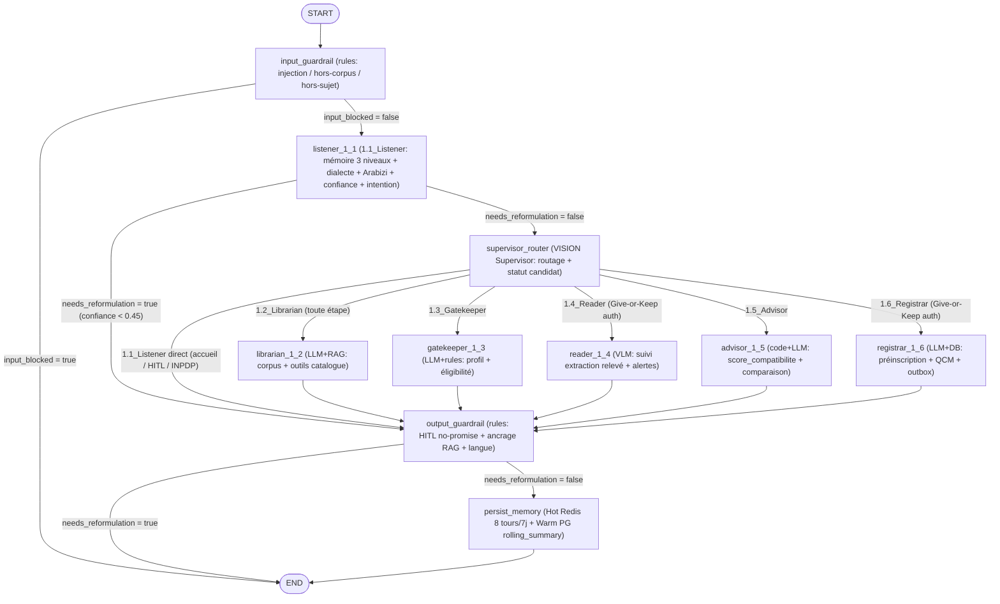
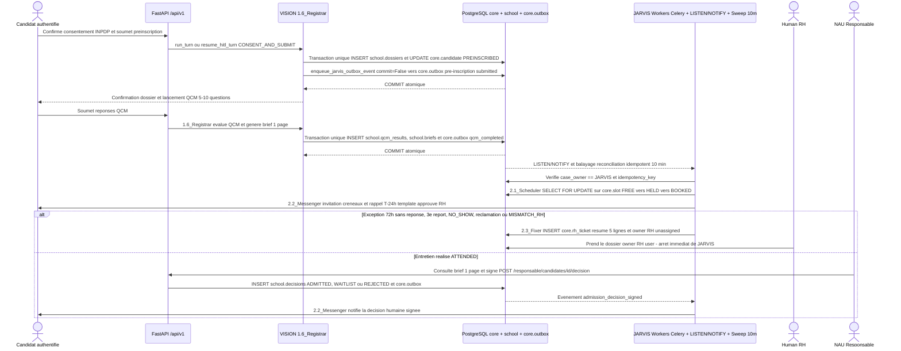

# SmartCampus AI — Architecture Agentique & Orchestration Multi-Agents (`SA-69`)

> **Tâche :** `[SA-69]` Choisir et structurer l'architecture agentique (Superviseur VISION / JARVIS)  
> **Références Backlog :** Epic `SA-67` (Orchestration des Agents IA) · Story `SA-68` (Concevoir et orchestrer le système multi-agents) · Issue GitHub `#73`  
> **Implémentation associée :** `backend/app/schemas/agent.py`, `backend/app/services/vision_supervisor.py`, `backend/app/services/llm_service.py`, `backend/app/api/v1/endpoints/chat.py`, `backend/app/api/v1/endpoints/voice_notes.py`  
> **Runtime d'orchestration :** `langgraph>=0.6.0,<1.0.0` & `langchain-core>=0.3.0,<1.0.0` (`StateGraph`, `MemorySaver`, `interrupt`, `Command`)  
> **Principe directeur :** *"VISION talks, JARVIS follows up, humans decide : les agents absorbent le volume conversationnel et la coordination, les règles et le code bornent ce qu'ils peuvent faire, et chaque recommandation est sourcée, mesurée et validée par un humain."*

---

## 1. Contexte exécutif, objectifs et invariants non négociables

SmartCampus AI est la plateforme agentique, multilingue (**Français**, **Arabe standard / Fusha**, **Derja tunisienne**, **Arabizi**) et multimodale (**texte / voix**) d'orientation et de préinscription pour les écoles **IIT** et **ISB** (avec **ISA** comme extension annoncée au sein de l'écosystème universitaire NAU à Sfax).

Le choix d'architecture agentique (`SA-69`) répond simultanément à cinq contraintes opérationnelles et académiques :

1. **Objectif de latence interactive :** maintenir un temps de réponse texte cible **`p95 < 4 s`** (objectif à mesurer en campagne d'évaluation et de charge, non encore acquis) en bornant strictement le nombre de sauts LLM par tour conversationnel.
2. **Déploiement local-first sur modèles open-source (`<= 9B`) :** conformément aux directives académiques du projet, la plateforme ne dépend d'aucune API LLM cloud externe propriétaire. L'orchestration s'exécute en local via **Ollama** (`qwen3:8b` avec `LLM_ENABLE_THINKING=false` injectant `/no_think`, `qwen2.5:7b-instruct`, adaptateur QLoRA unique `smartcampus-vision-8b`, VLM `qwen2.5vl:7b`, embeddings `bge-m3` `1024d`, reranker `BAAI/bge-reranker-v2-m3`, et Whisper STT local sans clé `WHISPER_PROVIDER=local`), tout en conservant un repli déterministe hors-ligne (`LLM_FALLBACK_TO_MOCK=true`) pour les tests unitaires et la CI.
3. **Gouvernance Human-in-the-Loop (HITL) absolue :** aucun agent IA, aucun nœud de graphe et aucun outil ne peut admettre, mettre en liste d'attente ou refuser un candidat (`ADMITTED | WAITLIST | REJECTED`). Seul le **Responsable** humain de l'école concernée détient et signe la décision finale d'admission.
4. **Ancrage strict sur les faits officiels :** les frais de scolarité, les dates de campagnes, les prérequis et les contenus de formations ne sont jamais inventés à partir des poids d'un modèle. Ils proviennent exclusivement des tables PostgreSQL du catalogue (`core.program`, `core.program_prerequisite`, `core.program_fee`, `core.admission_campaign`) et des passages indexés (`vector(1024)` `bge-m3` + `TSVECTOR`) avec citations dans `knowledge.chunks`, mis à jour par le **`Responsable`** (cloisonné par école `iit | isb | isa`).
5. **Maintenabilité pour une équipe de 5 développeurs :** des contrats Python typés (`Pydantic v2` + `Protocol` + `TypedDict`) permettent aux tâches Sprint 2 en aval (`SA-70`, `SA-71`, `SA-73`, `SA-74`, `SA-75`, `SA-82`, `SA-83`, `SA-84`) de se brancher en parallèle sur le superviseur sans conflits de fusion ni réécriture du flux de contrôle.

### Invariants architecturaux supplémentaires

- **Règle d'accès progressive (`Visiteur -> Candidat`, « Give or Keep ») :** la discussion, la recherche RAG et la simulation d'orientation restent 100 % ouvertes à tout `Visiteur` (lycéen, étudiant ou parent/proche, session invité Redis glissante de 7 jours, `actor_stage = "VISITOR"`). L'authentification (OTP email/téléphone ou Google OAuth avec fusion automatique de session et effacement du cookie invité, promouvant l'utilisateur en `actor_stage = "CANDIDATE"`) est imposée uniquement au premier événement parmi : téléversement d'un relevé de notes officiel, sauvegarde/envoi par email d'une shortlist, démarrage de la préinscription ou réservation d'un créneau d'entretien. Les réponses `ChatMessageResponse` et `VoiceNoteProcessResponse` exposent explicitement `actor_stage` (`VISITOR | CANDIDATE | RESPONSABLE`) et `candidate_status`, et `DefaultActionGuard` / `deps.py` normalisent de façon transparente les alias `candidate` / `candidat` <-> `student` et `visitor` / `visiteur` <-> `guest`.
- **Conformité protection des données (Loi organique n° 2004-63 / INPDP) :** consentement explicite tracé dans `core.consent` avant le traitement du relevé et la soumission du dossier ; masquage des données personnelles (PII) dans les journaux d'audit (`core.audit_log`) et traces techniques.
- **Séparation stricte Front-Office / Back-Office :** `VISION` (synchrone, étapes 1 à 7) et `JARVIS` (asynchrone, étape 8) partagent la couche de données PostgreSQL mais ne s'importent ni ne s'appellent jamais directement. La passation s'effectue exclusivement par écriture transactionnelle dans `core.outbox`.
- **Propriétaire unique par dossier (`One Owner`) :** `case_owner` appartient strictement à `{"JARVIS", "RH:<user>"}`. Toute prise en charge par `Human RH` suspend immédiatement l'ensemble des relances automatisées de `JARVIS`.
- **Abstraction des sous-agents :** les utilisateurs humains n'interagissent jamais directement avec les sous-agents internes (`1.1_Listener`..`1.6_Registrar`, `2.1_Scheduler`..`2.3_Fixer`). Toute action modifiant l'état métier est journalisée (qui / quoi / pourquoi).

---

## 2. Analyse comparative des architectures agentiques (ADR `SA-69`)

Afin de justifier formellement l'architecture retenue, quatre familles d'orchestration ont été évaluées selon les **quatre critères clés** du projet : **Complexité**, **Coût**, **Performance / Latence**, et **Adéquation aux besoins SmartCampus AI**.

### 2.1 Tableau comparatif multicritères

| Critère | Option 1 : Prompt monolithique plat (Socle Sprint 1) | Option 2 : Boucle ReAct libre (`AgentExecutor` non borné) | Option 3 : Frameworks multi-agents pair-à-pair (`CrewAI` / `AutoGen`) | Option 4 (Retenue) : Superviseur LangGraph `StateGraph` borné (`VISION`) + Workers `Outbox`/Celery (`JARVIS`) |
| :--- | :--- | :--- | :--- | :--- |
| **Complexité (équipe de 5 devs)** | **Très faible** au démarrage, mais le prompt système unique devient ingérable dès l'ajout des 6 rôles et des outils métier. | **Moyenne**, mais comportement non déterministe difficile à déboguer et à stabiliser en CI hors-ligne. | **Élevée** : abstraction lourde orientée conversations inter-agents, sur-ingénierie pour des règles métiers strictes et multiplication des couches de dépendances. | **Maîtrisée et modulaire** : un seul graphe explicite (`10` nœuds typés), contrats Python stables (`agent.py`), dépendances légères bornées (`langgraph>=0.6.0,<1.0.0` + `langchain-core>=0.3.0,<1.0.0`, sans monolithe `langchain`). |
| **Coût (tokens & infrastructure locale)** | Faible par appel, mais contexte système très volumineux répété à chaque tour sans spécialisation des prompts ni des outils. | **Imprévisible et élevé** : `N` itérations « Thought -> Action -> Observation » surchargent les GPU locaux (7-8B) et gonflent la consommation de tokens. | **Élevé** : échanges textuels verbeux entre personas LLM sur plusieurs tours internes ; inadapté à un hébergement local frugal. | **Minimal et prévisible (0 EUR d'API cloud externe)** : inférence 100 % locale open-source, `<= 2` appels LLM max en régime nominal, mémoire 3 niveaux visant ~1 200 tokens/appel (estimation à mesurer) au lieu d'un historique brut. |
| **Performance et latence (`p95 < 4 s` cible)** | **Rapide** (`1` appel LLM), mais aucun court-circuit structuré par sous-agent et forte dérive qualitative sur les tâches spécialisées. | **Risque fort de dépassement** (`6-15 s+` dès 3-4 appels séquentiels en local), variance élevée incompatible avec la cible `p95 < 4 s`. | **Lente** : orchestration multi-tours interne inadaptée au temps réel conversationnel étudiant. | **Optimale pour la cible `< 4 s`** : courts-circuits déterministes (`< 10 ms`) sur `input_guardrail` et `needs_reformulation`, 1 seul nœud spécialisé exécuté par tour, tâches back-office totalement découplées en asynchrone (`JARVIS`). |
| **Besoins SmartCampus AI (HITL, Give-or-Keep, Audit, Mémoire 3 niveaux)** | **Insuffisant** : pas de périmètre d'outils par sous-agent, pas de pause/reprise native `interrupt()`, mélange front/back difficile à cloisonner. | **Risqué** : une injection de prompt peut détourner l'agent vers un outil non autorisé ; contrôle fragile des transitions `CandidateStatus` et de la règle *Give or Keep*. | **Inadapté** : ne modélise pas proprement les frontières code déterministe vs LLM (ex. `SELECT ... FOR UPDATE`, règles YAML) ni le pattern transactionnel `core.outbox`. | **Adéquation complète** : guardrails entrée/sortie garantis par la topologie du graphe, `interrupt()` / `Command(resume=...)` natif avec checkpointer (`MemorySaver` -> `AsyncPostgresSaver`), séparation stricte `VISION` / `JARVIS` par `core.outbox`, auditabilité complète. |

### 2.2 Décision architecturale (ADR)

- **Décision :** adopter l'**Option 4** — un **Superviseur `VISION` compilé avec LangGraph (`StateGraph`)** pour le front-office synchrone (étapes 1 à 7), strictement découplé via la table PostgreSQL **`core.outbox`** d'un **orchestrateur back-office sans état `JARVIS`** piloté par événements et temporisations Celery (étape 8).
- **Pourquoi rejeter l'Option 1 (Prompt plat) :** dès Sprint 2 (RAG + catalogue + éligibilité + VLM + préinscription + QCM), concentrer toutes les consignes et tous les outils dans un seul prompt dégrade le suivi d'instructions des modèles locaux 7-8B et empêche d'appliquer un contrôle granulaire par sous-agent (`SubAgentConfig.allowed_tools`, `requires_auth`).
- **Pourquoi rejeter l'Option 2 (ReAct libre) :** un agent libre qui boucle sans garde topologique augmente la latence de queue, expose une surface plus large aux injections de prompt et complique la démonstration de conformité HITL devant le jury.
- **Pourquoi rejeter l'Option 3 (CrewAI / AutoGen) :** ces frameworks encouragent des discussions libres entre agents LLM pour des tâches que SmartCampus AI résout de façon beaucoup plus fiable et rapide par du code déterministe (règles YAML d'éligibilité, `score_compatibilite()`, verrouillage SQL des créneaux).
- **Règle d'or de conception retenue :** *"Les agents décident de la prochaine action conversationnelle ; les règles et le code déterministe décident de ce qui est autorisé."*

---

## 3. Matrice des responsabilités : Agents IA vs Backend déterministe vs Validations humaines

Conformément à la rigueur d'ingénierie du projet, **le code déterministe n'est jamais qualifié d'« agent IA »**. Chaque composant porte son type technique exact défini dans `ComponentImplementationType` (`backend/app/schemas/agent.py`) : `LLM`, `LLM+RAG`, `LLM+rules`, `VLM`, `code+LLM`, `rules` ou `code`.

### 3.1 Inventaire typé des unités multi-agents et transversales

| Orchestrateur | Unité / Nœud | Identifiant canonique | Type technique exact | Rôle précis |
| :--- | :--- | :--- | :--- | :--- |
| **Transversal** | Guardrail d'entrée | `input_guardrail` | `rules` | Bloque les tentatives d'injection de prompt, les pièges hors-catalogue et le hors-sujet avant toute inférence LLM. |
| **`VISION`** (Front-office, `StateGraph`, étapes 1-7) | Superviseur / Routeur | `supervisor_router` | `LLM` / routage supervisé | Planifie la prochaine étape et achemine le tour vers l'unique sous-agent spécialisé compétent. |
| **`VISION`** | Listener | `1.1_Listener` (`listener_1_1`) | `LLM` (+ Whisper STT + regex Arabizi) | Détecte langue/dialecte (FR/Fusha/Derja/Arabizi), normalise l'Arabizi, évalue la confiance (`< 0.45` -> reformulation FR) et classe l'intention. |
| **`VISION`** | Librarian | `1.2_Librarian` (`librarian_1_2`) | `LLM+RAG` | Répond sur le catalogue et le corpus officiel IIT/ISB/ISA **à toute étape du parcours**, avec citations obligatoires ou refus explicite sans source. |
| **`VISION`** | Gatekeeper | `1.3_Gatekeeper` (`gatekeeper_1_3`) | `LLM+rules` | Extrait les faits déclarés du profil ; les règles déterministes (YAML / tables DB) statuent sur l'éligibilité et les passerelles. |
| **`VISION`** | Reader | `1.4_Reader` (`reader_1_4`) | `VLM` (+ pypdf / Pillow) | Extrait les matières, notes et moyennes d'un relevé officiel après authentification avec score de confiance par champ. |
| **`VISION`** | Advisor | `1.5_Advisor` (`advisor_1_5`) | `code+LLM` | Calcule `score_compatibilite()` par code déterministe (critères académiques et intérêts uniquement) puis explique 2 à 3 parcours côte à côte. |
| **`VISION`** | Registrar | `1.6_Registrar` (`registrar_1_6`) | `LLM` (+ transactions DB) | Accompagne le pré-remplissage de préinscription, le consentement INPDP, le QCM issu de la banque validée, le brief 1 page et l'émission `core.outbox`. |
| **Transversal** | Guardrail de sortie | `output_guardrail` | `rules` (+ ancrage RAG `SA-97`) | Neutralise toute promesse d'admission (HITL), vérifie l'ancrage des frais/citations sur les passages retrouvés, vérifie la langue de réponse et l'absence de statut interdit. |
| **`JARVIS`** (Back-office, événementiel/timers, sans état, étape 8 — type de référence `JarvisSubAgent`) | Scheduler | `2.1_Scheduler` | `code` | Gère les créneaux (`FREE / HELD / BOOKED`) sans double réservation (`UNIQUE(responsable_id, start_time)` + `SELECT ... FOR UPDATE`). |
| **`JARVIS`** | Messenger | `2.2_Messenger` | `LLM` (borné par templates RH) | Personnalise les relances (T-24h, 24h, 48h) à partir de modèles approuvés par RH, interprète confirmer/déplacer/annuler et notifie la décision humaine signée. |
| **`JARVIS`** | Fixer | `2.3_Fixer` | `LLM+rules` (`rules + LLM`) | Libère les créneaux annulés, gère la liste d'attente (blocage 15 min aux 3 suivants), applique `reschedules <= 2` et ouvre `core.rh_ticket` avec résumé 5 lignes. |
| **Optionnel (*stretch*)** | Assistant analytique | `ATLAS` | `LLM` | Traduit les questions de la `Direction` en requêtes SQL en lecture seule sur vues agrégées (hors chemin critique). |

### 3.2 Répartition par étape du pipeline (Agents IA vs Backend déterministe vs Humains)

| Étape & Phase | Statut candidat (`CandidateStatus`) | Décisions confiées aux Agents IA | Traitements Backend déterministes (Code / Règles / DB) | Validation humaine obligatoire (HITL) |
| :--- | :--- | :--- | :--- | :--- |
| **1. Talk** (Découverte anonyme) | `ANONYMOUS` | `1.1_Listener` (`LLM`) : identification d'intention et réponse dans le registre exact de l'étudiant. | `input_guardrail` (`rules`), `detect_dialect()`, `normalize_arabizi_to_french()`, Whisper STT local, rate-limiting par IP/session, session invité signée Redis (TTL 7j). | Aucune (sauf relecture/correction facultative de la transcription vocale par l'étudiant). |
| **2. Ask & Build Profile** (Découverte anonyme) | `ANONYMOUS -> PROFILING` | `1.2_Librarian` (`LLM+RAG`) : synthèse pédagogique sourcée. `1.3_Gatekeeper` (`LLM+rules`) : extraction des faits déclarés en conversation. | Recherche hybride `pgvector` + FTS (`knowledge.chunks`), outils catalogue en lecture seule (`core.program*`), `output_guardrail` (vérification citations et frais), mise à jour mémoire chaude Redis + synthèse glissante `<= 300 tokens`. | Administration du corpus officiel et des fiches programmes par `Platform Admin` / `NAU Responsable`. |
| **3. Check Eligibility & Equivalence** | `PROFILING -> ELIGIBLE \| INELIGIBLE` | `1.3_Gatekeeper` (`LLM+rules`) : vulgarisation des conditions et proposition d'alternatives en cas de non-éligibilité. | Moteur de règles déterministe (YAML + `core.program_prerequisite`) calculant `ELIGIBLE`, `BORDERLINE_TO_CONFIRM` ou `INELIGIBLE` sans interprétation libre du LLM. | Tout cas limite ou demande d'équivalence/passerelle (`BORDERLINE_TO_CONFIRM`) est marqué **« à confirmer par le Responsable NAU »** (`core.equivalence_requests`). |
| **4. Recommend 2-3 Tracks** | `ELIGIBLE -> ORIENTED` | `1.5_Advisor` (`code+LLM`) : explication comparative transparente des 2 à 3 parcours retenus. | `score_compatibilite()` en code pur (uniquement critères académiques et intérêts déclarés, zéro variable sensible) + lecture des frais/campagnes en base PostgreSQL. | L'étudiant choisit librement son parcours cible ; aucun choix n'est imposé par l'agent. |
| **5. Log in & Merge** (Parallèle « Give or Keep ») | `ORIENTED -> AUTHENTICATED` | `1.6_Registrar` / `1.4_Reader` : déclenchent `actionPrompt="AUTH_REQUIRED"` si le visiteur n'est pas authentifié. | OTP email/téléphone, Google OAuth, émission JWT HS256, fusion atomique Redis -> PostgreSQL (`core.candidate`, `core.candidate_profile`, `core.shortlist`, `core.guest_sessions`). | L'étudiant initie sa connexion et accepte explicitement le consentement **INPDP (Loi n° 2004-63)** dans `core.consent`. |
| **6. Pre-inscription & Relevé VLM** | `AUTHENTICATED -> PREINSCRIBED` | `1.4_Reader` (`VLM`) : lecture structurée du relevé officiel. `1.6_Registrar` (`LLM`) : guidage conversationnel du pré-remplissage. | Validation octets magiques et taille, stockage chiffré objet (`core.document`), recalcul arithmétique de moyenne, détection d'écart `> 0.25` et confiance `< 0.85`, écriture atomique `core` + `<school>.dossiers` (`iit`/`isb`/`isa`) + `core.outbox` (`"pre-inscription submitted"`), journal `core.audit_log`. | **Checkpoint `RELEVE_CONFIRMATION`** (l'étudiant valide les champs surlignés `< 0.85`), **checkpoint `CONSENT_AND_SUBMIT`** avant soumission, et **checkpoint `RH_MISMATCH_ESCALATION`** (`MISMATCH_RH` -> arbitrage `Human RH` sans jamais rejeter automatiquement). |
| **7. Short QCM & 1-Page Brief** | `PREINSCRIBED -> QCM_DONE` | `1.6_Registrar` (`LLM`) : rédaction de la synthèse qualitative du brief 1 page (aide à l'entretien uniquement). | Tirage de 5 à 10 questions depuis la banque approuvée (sans exposer les clés de réponse), notation déterministe (`<school>.qcm_results`), persistance `<school>.briefs`, émission `core.outbox` (`"qcm_completed"`). | Validation préalable de la banque de QCM par `Platform Admin` / `NAU Responsable`. |
| **8. Follow-up (Booking, Reminders, Escalation)** | `QCM_DONE -> SCHEDULED` (ou `DORMANT` / `ESCALATED`) | `2.2_Messenger` (`LLM` borné par templates) : personnalisation de registre et classification d'intention de réponse. `2.3_Fixer` (`LLM+rules`) : résumé 5 lignes pour ticket RH. | `2.1_Scheduler` (`code`) : verrou SQL `SELECT ... FOR UPDATE`, `UNIQUE(responsable_id, start_time)`, timers Celery ETA, balayage 10 min, clé d'idempotence `appointment_id + message_type`, plafond `reschedules <= 2`, blocage liste d'attente 15 min. | `Human RH` approuve les modèles de messages et prend la main (`owner = RH:<user>`) sur toutes les exceptions (72h sans réponse, 3e report, `NO_SHOW`, réclamation, dérogation). |
| **9. Interview & Final Decision** | `SCHEDULED -> INTERVIEWED -> ADMITTED \| WAITLIST \| REJECTED` | **Aucun agent décisionnaire.** Après signature humaine uniquement, `2.2_Messenger` envoie la notification approuvée. | Contrôle RBAC + RLS PostgreSQL sur `<school>.decisions`, verrou `FORBIDDEN_AGENT_STATUSES`, journalisation `core.audit_log`, politique de rétention/archivage. | **Décision 100 % humaine et exclusive du `NAU Responsable`** de l'école concernée (`ADMITTED`, `WAITLIST` ou `REJECTED` signé sur `/api/v1/responsable/candidates/{id}/decision`). |
| **Transversal — Sync Corpus RAG** | Hors cycle candidat | Aucun agent IA décisionnaire (embeddings locaux uniquement). | Pipeline de détection de changements et de synchronisation (`SA-56`) : hash SHA-256, versionnage immuable `v{N}`, suivi via `core.document_sync_jobs` et `core.document_sync_logs`, bascule atomique `knowledge.chunks` (`SA-57`/`SA-58`). | Publication, archivage ou suppression des documents officiels par `Platform Admin` / `NAU Responsable`. |

---

## 4. Graphe d'états du superviseur `VISION` et schéma d'état partagé (`#73`)

Le superviseur front-office est compilé en un véritable graphe LangGraph **`StateGraph(VisionAgentState)`** exposé via l'attribut `VisionSupervisor.compiled_graph` dans `backend/app/services/vision_supervisor.py` (`VisionSupervisor._compile_supervisor_graph()`), adossé à un `BaseCheckpointSaver` (`MemorySaver` par défaut).

### 4.1 Topologie compilée du graphe `VISION` (10 nœuds)



### 4.2 Registre exact des nœuds et table des transitions

Les identifiants de nœuds sont figés dans `VISION_GRAPH_NODES`, `SUBAGENT_TO_NODE` et `NODE_TO_SUBAGENT` (`backend/app/services/vision_supervisor.py`) :

| Constante Python | Nom de nœud LangGraph | Sous-agent / Rôle | Condition d'entrée | Transitions sortantes exactes | Borne / Politique appliquée |
| :--- | :--- | :--- | :--- | :--- | :--- |
| `NODE_INPUT_GUARDRAIL` | `input_guardrail` | Cross-cutting (`rules`) | `START` (toujours premier) | `END` si `input_blocked == True` ; sinon `listener_1_1` | Court-circuit immédiat `< 10 ms` ; 0 appel LLM sur attaque ou hors-sujet. |
| `NODE_LISTENER` | `listener_1_1` | `1.1_Listener` (`LLM`) | `input_guardrail` validé | `output_guardrail` si `needs_reformulation == True` ; sinon `supervisor_router` | Charge Hot Redis + Warm PG (`CandidateProfile` uniquement si `is_authenticated == True` et `candidate_id` authentifié présent, jamais via `session_id`), normalise l'Arabizi, impose reformulation FR si confiance `< 0.45`. |
| `NODE_SUPERVISOR_ROUTER` | `supervisor_router` | Superviseur `VISION` | `listener_1_1` confiant | `librarian_1_2`, `gatekeeper_1_3`, `reader_1_4`, `advisor_1_5`, `registrar_1_6`, ou `output_guardrail` (cas `1.1_Listener` direct) | Détecte les requêtes OCR/VLM explicites (`1.4_Reader`), met à jour `candidate_status` via `assert_vision_status_transition_allowed()`. |
| `NODE_LIBRARIAN` | `librarian_1_2` | `1.2_Librarian` (`LLM+RAG`) | Routé par `supervisor_router` | `output_guardrail` | **Disponible à toute étape** (`requires_auth=False`) ; accès aux outils RAG et catalogue `PUBLIC_READ`. |
| `NODE_GATEKEEPER` | `gatekeeper_1_3` | `1.3_Gatekeeper` (`LLM+rules`) | Routé par `supervisor_router` | `output_guardrail` | Ouvert aux visiteurs anonymes (`requires_auth=False`) ; règles déterministes décident l'éligibilité. |
| `NODE_READER` | `reader_1_4` | `1.4_Reader` (`VLM`) | Routé par `supervisor_router` | `output_guardrail` | **Protégé Give-or-Keep (`requires_auth=True`)** : émet `HitlInterruptSpec(reason="AUTH_REQUIRED")` si anonyme ; expose `RELEVE_CONFIRMATION` / `RH_MISMATCH_ESCALATION` si anomalie VLM. |
| `NODE_ADVISOR` | `advisor_1_5` | `1.5_Advisor` (`code+LLM`) | Routé par `supervisor_router` | `output_guardrail` | Ouvert aux visiteurs anonymes (`requires_auth=False`) ; combine `score_compatibilite()` et outils catalogue. |
| `NODE_REGISTRAR` | `registrar_1_6` | `1.6_Registrar` (`LLM`) | Routé par `supervisor_router` | `output_guardrail` | **Protégé Give-or-Keep (`requires_auth=True`)** : exige authentification + consentement INPDP ; émet `OutboxHandoffSpec` sans jamais appeler `JARVIS`. |
| `NODE_OUTPUT_GUARDRAIL` | `output_guardrail` | Cross-cutting (`rules`) | Toute sortie de nœud métier ou reformulation | `END` si `needs_reformulation == True` ; sinon `persist_memory` | Vérifie l'absence de statut dans `FORBIDDEN_AGENT_STATUSES`, neutralise toute promesse d'admission et ajoute l'avertissement frais non ancrés. |
| `NODE_PERSIST_MEMORY` | `persist_memory` | Persistance mémoire (`code`) | `output_guardrail` terminé (hors reformulation) | `END` | Ajoute le couple `(user, assistant)` dans Redis (`HotConversationService`) et met à jour `rolling_summary` dans Redis + PostgreSQL (`CandidateProfile` uniquement si `is_authenticated == True` et `candidate_id` authentifié présent, jamais via `session_id`). |

> **Garantie de latence :** chaque tour traverse au maximum **un seul nœud métier** entre `supervisor_router` et `output_guardrail`, ce qui borne strictement le chemin critique à `<= 1` génération LLM principale (ou `<= 2` avec sélection d'outil structurée dans `SA-70`).

### 4.3 Configuration par défaut des 6 sous-agents (`DEFAULT_SUBAGENT_CONFIGS`)

Définie par `build_default_subagent_configs()` dans `backend/app/services/vision_supervisor.py` (surchargeable par `SA-75`) :

| Sous-agent (`VisionSubAgent`) | `component_type` | `requires_auth` | `temperature` | `max_tokens` | `allowed_tools` par défaut |
| :--- | :--- | :---: | :---: | :---: | :--- |
| `1.1_Listener` | `LLM` | `False` | `0.2` | `512` | `()` |
| `1.2_Librarian` | `LLM+RAG` | `False` | `0.1` | `1024` | `rag_hybrid_search_tool`, `list_school_programs_tool`, `get_program_details_tool`, `compare_programs_tool`, `get_program_prerequisites_and_fees_tool` |
| `1.3_Gatekeeper` | `LLM+rules` | `False` | `0.1` | `768` | `evaluate_eligibility_tool`, `get_program_prerequisites_and_fees_tool` |
| `1.4_Reader` | `VLM` | `True` | `0.0` | `768` | `get_transcript_extraction_status_tool` |
| `1.5_Advisor` | `code+LLM` | `False` | `0.2` | `1024` | `compute_compatibility_score_tool`, `list_school_programs_tool`, `get_program_details_tool`, `compare_programs_tool`, `get_program_prerequisites_and_fees_tool` |
| `1.6_Registrar` | `LLM` | `True` | `0.1` | `1024` | `prefill_preinscription_tool`, `submit_preinscription_tool`, `start_qcm_session_tool`, `list_available_slots_tool` |

### 4.4 Schéma d'état partagé `VisionAgentState` (`backend/app/schemas/agent.py`)

`VisionAgentState` est un `TypedDict(total=False)` **100 % sérialisable JSON** afin d'être persisté sans erreur par tout checkpointer LangGraph (`MemorySaver` ou `AsyncPostgresSaver`). Les poignées d'exécution non sérialisables (`db`, `redis_client`, `request_payload`, `tool_dispatcher`, `action_guard`, `requested_tool_calls`) sont injectées séparément dans `RunnableConfig["configurable"]`.

| Domaine | Clés exactes de `VisionAgentState` | Types Python | Rôle dans le graphe |
| :--- | :--- | :--- | :--- |
| **Identité, Threading & Auth** | `thread_id`, `session_id`, `memory_scope_key`, `candidate_id`, `account_id`, `is_authenticated`, `actor_role`, `campus_scope` | `str`, `str`, `str`, `str \| None`, `str \| None`, `bool`, `ActorRole`, `CampusScope` | Corrélation checkpoint strictement cloisonnée par périmètre d'authentification (`vision:candidate:<candidate_id>`, `vision:account:<account_id>`, `vision:guest:<session_id>`), isolation *Give or Keep* / anti-IDOR et filtre d'établissement (`all \| IIT \| ISB \| ISA`). |
| **Cycle de vie & Propriété** | `candidate_status`, `case_owner` | `CandidateStatus`, `str` | État canonique parmi les 16 statuts PostgreSQL et verrou d'exclusivité (`"JARVIS"` ou `"RH:<id>"`). |
| **Entrée & NLU (`1.1_Listener`)** | `user_message`, `is_voice`, `language_hint`, `explicit_dialect`, `detected_language`, `detected_dialect`, `normalized_french_query`, `intent`, `comprehension_confidence`, `needs_reformulation`, `reformulation_prompt` | `str`, `bool`, `LanguageHint`, `DetectedDialect \| None`, `str`, `DetectedDialect`, `str \| None`, `str`, `float`, `bool`, `str \| None` | Trace complète du pré-traitement multilingue/Arabizi, du score de confiance et du repli vers une reformulation française. |
| **Mémoire 3 niveaux** | `recent_turns`, `declared_facts`, `rolling_summary`, `history_turn_count` | `list[dict[str, Any]]`, `dict[str, Any]`, `str \| None`, `int \| None` | Instantané borné des derniers tours Redis (`<= 16` messages), des faits académiques et de la synthèse glissante (`<= 300 tokens`). |
| **Routage, Outils & Citations** | `active_sub_agent`, `routed_node`, `nodes_visited`, `tool_calls`, `retrieved_chunks`, `citations`, `action_prompt`, `suggested_actions` | `VisionSubAgent`, `str`, `list[str]`, `list[dict[str, Any]]`, `list[dict[str, Any]]`, `list[dict[str, Any]]`, `ActionPrompt \| None`, `list[str]` | Traçabilité des nœuds traversés, des appels d'outils (`ToolCallRecord`), des extraits RAG/catalogue et des invitations d'action UI. |
| **Guardrail, HITL & Outbox** | `input_blocked`, `guardrail_triggered`, `guardrail_action`, `hitl_interrupt`, `hitl_resume_payload`, `outbox_events` | `bool`, `bool`, `str \| None`, `dict[str, Any] \| None`, `dict[str, Any] \| None`, `list[dict[str, Any]]` | Journalisation des interventions de sécurité, spécification de pause HITL et événements `OutboxHandoffSpec` prêts pour `core.outbox`. |
| **Génération & Télémétrie** | `draft_reply`, `final_reply`, `provider`, `model_used`, `used_fallback`, `started_at_ns`, `latency_ms` | `str`, `str`, `str`, `str`, `bool`, `int`, `int` | Séparation brouillon / texte assaini par `output_guardrail`, suivi fournisseur local/mock et latence mesurée en millisecondes. |

---

## 5. Checkpoints HITL LangGraph (`interrupt()`), persistance et verrous anti-décision

### 5.1 Catalogue des points de contrôle humains (`HitlInterruptReason`)

Les quatre points de suspension humains autorisés dans `VISION` sont typés par `HitlInterruptReason` et encapsulés dans `HitlInterruptSpec` (`backend/app/schemas/agent.py`) :

| Motif (`HitlInterruptReason`) | Sous-agent émetteur | Condition de déclenchement | Payload de pause (`HitlInterruptSpec`) | Contrat de reprise (`Command(resume=...)`) |
| :--- | :--- | :--- | :--- | :--- |
| `AUTH_REQUIRED` | `1.4_Reader`, `1.6_Registrar` | Visiteur non authentifié demandant un dépôt de relevé, une préinscription ou une réservation (règle *Give or Keep*). | `action_prompt="AUTH_REQUIRED"`, `required_confirmation_fields=["authentication"]`, `session_id`, `intent`. | `{ "confirmed": true, "authenticated": true, "candidate_id": "<uuid>", "target_status": "AUTHENTICATED" }`. |
| `RELEVE_CONFIRMATION` | `1.4_Reader` | Extraction VLM avec au moins un champ sous le seuil de confiance (`< 0.85`, `needs_manual_review=True`). | `action_prompt="UPLOAD_RELEVE"`, `required_confirmation_fields=<low_confidence_fields>`, métadonnées `transcript_extraction`. | `{ "confirmed": true, "corrected_fields": {...} }` validé explicitement par l'étudiant. |
| `CONSENT_AND_SUBMIT` | `1.6_Registrar` | Formulaire de préinscription pré-rempli prêt pour soumission vers `iit`, `isb` ou `isa`. | Consentement explicite INPDP (Loi n° 2004-63), récapitulatif du programme cible et des pièces jointes. | `{ "confirmed": true, "consent_granted": true, "candidate_id": "<uuid>", "school_code": "iit", "target_status": "PREINSCRIBED", "outbox_payload": {...} }`. |
| `RH_MISMATCH_ESCALATION` | `1.4_Reader`, `1.6_Registrar` | Écart persistant `> 0.25` entre moyenne déclarée et moyenne extraite du relevé officiel (`discrepancy_detected=True`). | `action_prompt="UPLOAD_RELEVE"`, champs en divergence, drapeau `MISMATCH_RH` pour ouverture de ticket RH. | `{ "confirmed": true, "target_status": "ESCALATED", "rh_ticket_reason": "DOCUMENT_MISMATCH" }`. |

### 5.2 Mécanisme réel `interrupt()` / `Command(resume=...)` et stratégie de checkpointer

Afin que les requêtes HTTP conversationnelles (`POST /api/v1/chat/message`) restent non bloquantes tout en offrant de véritables suspensions/reprises LangGraph vérifiables, `VisionSupervisor` compile un second graphe dédié **`hitl_checkpoint_graph`** (`_build_hitl_checkpoint_graph(checkpointer)`) partageant le même `BaseCheckpointSaver` :

1. **Suspension (`VisionSupervisor.run_hitl_checkpoint(thread_id, interrupt_spec, candidate_status)`) :**
   - Valide d'abord `candidate_status` via `assert_vision_status_transition_allowed()`.
   - Isole le checkpoint dans un espace de noms dédié **`vision_hitl:{thread_id}`** afin qu'un tour conversationnel `1.2_Librarian` sur le même `thread_id` n'écrase jamais un checkpoint HITL en pause.
   - Exécute le nœud `await_human_confirmation`, qui invoque réellement `langgraph.types.interrupt(spec)`.
   - Persiste l'instantané d'état dans `self.checkpointer` sous `config={"configurable": {"thread_id": "vision_hitl:<thread_id>"}}` et suit le thread actif dans un registre `OrderedDict` borné (`max_active_hitl_threads = 256`, éviction FIFO/LRU vers `delete_thread()`).
   - Retourne `{"thread_id", "checkpoint_thread_id", "interrupted": True, "interrupt_value", "next_nodes": ["await_human_confirmation"], "checkpoint_status": "AWAITING_HUMAN"}`.
2. **Reprise (`VisionSupervisor.resume_hitl_turn(thread_id, resume_payload)`) :**
   - Inspecte d'abord `snapshot = await self.hitl_checkpoint_graph.aget_state(cfg)` pour exiger un checkpoint actif en pause sur `await_human_confirmation` (lève `ValueError` si aucun checkpoint actif n'existe).
   - Valide ensuite tout `target_status` proposé via `assert_vision_status_transition_allowed(proposed_status, current_status=snapshot.values["candidate_status"], require_current_status=True)` (lève `PermissionError` sur `ADMITTED`, `WAITLIST`, `REJECTED` ou toute transition illégale telle que `ANONYMOUS -> PREINSCRIBED`).
   - Reprend le graphe exactement au point d'interruption via `self.hitl_checkpoint_graph.ainvoke(Command(resume=resume_payload), config=cfg)`.
   - Le nœud `apply_human_confirmation` vérifie impérativement **`consent_granted is True`** (consentement explicite INPDP Loi 2004-63) sur `CONSENT_AND_SUBMIT` / `PREINSCRIBED` avant d'approuver (`CONFIRMED`) et d'émettre `OutboxHandoffSpec` (`"pre-inscription submitted"`). Une fois la reprise achevée, le checkpoint `MemorySaver` consommé est purgé.
3. **Persistance des checkpoints (`thread_id`) et hygiène mémoire :**
   - Par défaut (tests unitaires et CI hors-ligne), `VisionSupervisor` instancie **`MemorySaver()`** : chaque tour `run_turn()` non interrompu purge immédiatement son thread `MemorySaver` (`adelete_thread()`), tandis que les pauses `interrupt()` (y compris issues d'un `SubAgentHandler` personnalisé) sont conservées sous un plafond FIFO/LRU (`max_active_hitl_threads = 256`) afin d'éviter toute fuite RAM dans le singleton applicatif.
   - Le constructeur accepte `checkpointer: BaseCheckpointSaver | None = None`, ce qui permet d'injecter **`AsyncPostgresSaver`** en production sans modifier une seule ligne du graphe (la purge `MemorySaver` ne s'applique pas aux checkpointers persistants), en corrélant `thread_id` (`vision:candidate:<id>` / `vision:guest:<sid>`) à la colonne `core.conversation_threads.langgraph_thread_id`.

### 5.3 Verrouillage multicouche interdisant les décisions d'admission par l'IA

La règle HITL (*« Humans decide »*) est appliquée en défense en profondeur à **cinq niveaux indépendants** :

1. **Niveau types (`backend/app/schemas/agent.py`) :** `ToolPermissionLevel` n'expose que `PUBLIC_READ`, `AUTH_READ` et `AUTH_STATE_CHANGE` ; aucun niveau de décision d'admission n'existe.
2. **Niveau machine à états (`FORBIDDEN_AGENT_STATUSES` & `ALLOWED_VISION_STATUS_TRANSITIONS`) :** `FORBIDDEN_AGENT_STATUSES = frozenset({"ADMITTED", "WAITLIST", "REJECTED"})`. La fonction `assert_vision_status_transition_allowed(target_status, current_status)` lève systématiquement `PermissionError` si un nœud, un handler custom (`SA-74`), un helper outbox ou un payload de reprise HITL tente d'émettre un statut de décision finale ou une transition non autorisée (par exemple `SCHEDULED`, qui appartient exclusivement à `JARVIS 2.1_Scheduler`).
3. **Niveau garde d'outils (`DefaultActionGuard` et `SA-71`) :** `authorize()` bloque avec `BLOCKED_HITL` tout outil dont le nom contient un mot-clé interdit (`admit`, `reject`, `waitlist`, `decide_admission`, `sign_decision`) ou dont les arguments véhiculent `ADMITTED | WAITLIST | REJECTED`, et marque `audit_required=True`.
4. **Niveau nœud de sortie (`_node_output_guardrail`) :** revérifie `state["candidate_status"]` (lève `PermissionError` en cas de statut interdit) et exécute `check_output_guardrail()` pour neutraliser toute promesse d'admission formulée en langage naturel.
5. **Niveau API REST & RLS PostgreSQL :** seul un acteur authentifié `role="responsable"` rattaché à l'école du dossier (`iit`, `isb` ou `isa`) peut appeler `POST /api/v1/responsable/candidates/{id}/decision` et insérer dans `<school>.decisions`.

---

## 6. Séparation événementielle stricte : `VISION` <-> `core.outbox` <-> `JARVIS`

`VISION` et `JARVIS` partagent la base PostgreSQL mais **ne se connaissent pas au niveau applicatif** : `backend/app/services/vision_supervisor.py` ne comporte **aucun import** ni appel vers les modules de planification, de créneaux ou de workers `JARVIS` (invariant vérifié par test unitaire statique).

### 6.1 Diagramme de séquence de passation transactionnelle



### 6.2 Contrat transactionnel `core.outbox` (`backend/app/schemas/agent.py` & `vision_supervisor.py`)

La passation repose sur deux constantes, un type école strict (`SchoolCodeLower = Literal["iit", "isb", "isa"]`) et deux helpers testés :

- `OutboxHandoffEventType = Literal["pre-inscription submitted", "qcm_completed"]`
- `OUTBOX_EVENT_BY_STATUS = {"PREINSCRIBED": "pre-inscription submitted", "QCM_DONE": "qcm_completed"}`
- `build_outbox_handoff_spec(candidate_id, target_status, school_code, payload)` : vérifie `assert_vision_status_transition_allowed(target_status)`, valide `target_status in OUTBOX_EVENT_BY_STATUS`, et retourne un `OutboxHandoffSpec`.
- `enqueue_jarvis_outbox_event(db, spec, commit=False)` : crée un enregistrement `OutboxEvent` (`core.outbox`) avec `aggregate_type="candidate"`, `aggregate_id=spec.aggregate_id`, `event_type=spec.event_type` et `payload` enrichi (`school_code`, `target_status`). Le paramètre `commit=False` par défaut garantit que `SA-82` et `SA-88` valident le dossier d'école et l'événement `core.outbox` dans **une unique transaction SQL atomique** (pattern Transactional Outbox : aucune perte d'événement et possibilité future de scinder les bases par école sans modifier les agents).

### 6.3 Règles d'exploitation back-office de `JARVIS` et matrice d'escalade RH

`JARVIS` est strictement **sans état entre deux déclenchements** : il reconstruit son contexte depuis les lignes relationnelles (`core.candidate`, `core.slot`, `core.appointment`, `core.appointment_event`, `core.rh_ticket`) sans conserver de transcription longue par réservation.

- **Trois mécanismes de déclenchement (aucun polling LLM) :**
  1. **Événement métier :** ligne `core.outbox` non traitée (`processed_at IS NULL`) consommée via `LISTEN/NOTIFY` ou worker dédié.
  2. **Temporisation :** tâches Celery avec ETA stockées avec le rendez-vous (T-24h, relances 24h/48h/72h) et annulées automatiquement à chaque changement d'état.
  3. **Balayage de sécurité :** réconciliation idempotente toutes les **10 minutes** couvrant tout événement manqué ou redémarrage de worker.
- **Garanties d'intégrité :**
  - **Zéro double réservation :** contrainte `UNIQUE(responsable_id, start_time)` sur `core.slot` + verrouillage `SELECT ... FOR UPDATE` (`FREE -> HELD -> BOOKED`).
  - **Idempotence des notifications :** clé unique `appointment_id + message_type` dans `core.appointment_event.idempotency_key`.
  - **Propriétaire unique (`One Owner`) :** avant toute action automatisée, `JARVIS` vérifie `candidate.owner == "JARVIS"`. Si `owner` commence par `"RH:"`, toute relance est immédiatement annulée jusqu'à restitution manuelle par `Human RH`.
  - **Liste d'attente automatique :** un créneau libéré est proposé aux 3 candidats suivants avec blocage temporaire (`HELD`) de 15 minutes ; la première confirmation gagne.
  - **Messages bornés par modèles :** `2.2_Messenger` ne rédige jamais d'engagements libres ; il personnalise uniquement des gabarits validés par `Human RH` (nom, date, registre linguistique).

| Situation opérationnelle | Action autorisée de `JARVIS` (`2.1` / `2.2` / `2.3`) | Déclencheur d'escalade vers `Human RH` (`core.rh_ticket` + arrêt auto) |
| :--- | :--- | :--- |
| Invitation d'entretien sans réponse | Relance à 24h, puis seconde relance à 48h. | **72h sans réponse** -> statut `DORMANT` + ouverture `rh_ticket` (résumé 5 lignes). |
| Demande d'annulation ou de report par le candidat | Libère le créneau (`CANCELLED` -> liste d'attente 15 min) et propose de nouveaux créneaux (`reschedules <= 2`). | **3e demande de modification (`reschedules > 2`)** -> `ESCALATED`, reprise RH. |
| Absence le jour de l'entretien | Enregistre `NO_SHOW` dans `core.appointment`. | **Immédiat** -> appel humain par `Human RH`. |
| Annulation par le `NAU Responsable` | Transmet des excuses et propose des créneaux prioritaires. | **Aucun créneau disponible sous 7 jours** -> escalade RH. |
| Discordance relevé / faible confiance persistante | Demande confirmation au candidat (`1.4_Reader`). | **Notes déclarées différentes du relevé officiel après confirmation** (`MISMATCH_RH`) -> ticket RH. |
| Réclamation, détresse, besoin spécifique, exception frais/délai | Accusé de réception neutre, sans aucun engagement. | **Immédiat** -> reprise exclusive `Human RH`. |

### 6.4 Machines à états canoniques alignées sur PostgreSQL (`models/base.py`)

- **Statuts candidat (`CandidateStatus`, 16 valeurs exactes) :**
  `ANONYMOUS -> PROFILING -> ELIGIBLE | INELIGIBLE -> ORIENTED -> AUTHENTICATED -> PREINSCRIBED -> QCM_DONE -> SCHEDULED -> INTERVIEWED -> ADMITTED | WAITLIST | REJECTED` ; états transversaux : `DORMANT`, `ESCALATED`, `WITHDRAWN`.
- **Statuts de rendez-vous (`APPOINTMENT_STATUS_VALUES`, 9 valeurs exactes) :**
  `AWAITING_SLOT -> INVITED -> BOOKED -> REMINDED -> ATTENDED` ; états d'exception/fin : `CANCELLED`, `NO_SHOW`, `ESCALATED`, `WITHDRAWN`.
- **Statuts de créneaux (`SLOT_STATUS_VALUES`, 3 valeurs exactes) :**
  `FREE`, `HELD`, `BOOKED`.

---

## 7. Déploiement local-first sur modèles open-source et mémoire 3 niveaux

### 7.1 Stratégie d'inférence locale (zéro dépendance API cloud externe)

Le backend applique un **découplage complet vis-à-vis des fournisseurs LLM** piloté par variables d'environnement (`backend/app/core/config.py`) afin de respecter l'exigence d'exécution locale sur modèles open-source auto-hébergés :

| Composant | Mode d'exécution local-first cible | Configuration runtime (`settings`) | Comportement CI / hors-ligne |
| :--- | :--- | :--- | :--- |
| **`VISION` (LLM principal)** | Modèle open-source `<= 9B` auto-hébergé via **Ollama** : `qwen3:8b` (`LLM_ENABLE_THINKING=false` injectant `/no_think`), `qwen2.5:7b-instruct` ou adaptateur QLoRA unique `smartcampus-vision-8b` (`Modelfile.smartcampus-vision-8b`). | `LLM_PROVIDER=ollama` (aucune clé cloud requise), `LLM_ENABLE_THINKING=false` (`/no_think` appliqué automatiquement sur `qwen3*` et `smartcampus-vision*`). | `LLM_PROVIDER=mock` ou `LLM_FALLBACK_TO_MOCK=true` -> repli déterministe multilingue `smartcampus-fallback-v1` sans réseau. |
| **`JARVIS` (`2.2_Messenger` / `2.3_Fixer`)** | Modèle open-source `<= 9B` local (`qwen2.5:7b-instruct` sur Ollama) pour classification d'intention courte et personnalisation sur gabarits RH. | Paramétrage indépendant par variable d'environnement, sans clé cloud codée en dur. | Repli déterministe sur gabarits pour les tests automatisés. |
| **`1.4_Reader` (VLM relevés)** | Modèle Vision-Language open-source local (`qwen2.5vl:7b` sur Ollama). | `VLM_PROVIDER=ollama`, `VLM_BASE_URL`, `VLM_MODEL=qwen2.5vl:7b` (sans clé cloud requise). | Parser PDF natif local (`pypdf` + recalcul pondéré) et `image_fallback` marquant `needs_manual_review=True`. |
| **`1.1_Listener` (Whisper STT)** | Whisper auto-hébergé localement (`whisper-large-v3` / `faster-whisper` local) + normaliseur déterministe `arabizi_normalizer.py`. | `WHISPER_PROVIDER=local` (appel sans clé vers `WHISPER_BASE_URL`), `WHISPER_MODEL=whisper-large-v3`. | Transcriptions simulées multilingues (`WHISPER_PROVIDER=mock` ou `openai_compatible` sans clé en CI). |
| **`1.2_Librarian` (Embeddings & Reranker RAG)** | `BAAI/bge-m3` (`1024d`) sur Ollama + reranker `BAAI/bge-reranker-v2-m3`, alignés sur `knowledge.chunks.embedding vector(1024)` (`pgvector` HNSW) et `TSVECTOR` RRF + CRAG. | `EMBEDDING_PROVIDER=ollama`, `EMBEDDING_MODEL=bge-m3`, `EMBEDDING_DIMENSION=1024`, `RERANKER_MODEL=BAAI/bge-reranker-v2-m3`. | Embeddings déterministes locaux `1024d` en CI (`SA-54`). |

> **Point de vérification dans `vision_supervisor.py` :** `_generate_reply_with_provider()` autorise nativement `provider == "ollama"` sans aucune clé `LLM_API_KEY`, tout en supportant un serveur `openai_compatible` local (vLLM / llama.cpp) et le repli `mock` déterministe.

### 7.2 Architecture de mémoire conversationnelle à 3 niveaux

L'orchestrateur `VISION` intègre directement la mémoire à 3 niveaux dans les nœuds `listener_1_1` (lecture) et `persist_memory` (écriture) :

| Niveau | Support technique | Contenu persisté | Durée de vie & bornes | Isolation *Give or Keep* |
| :--- | :--- | :--- | :--- | :--- |
| **Chaud (Hot)** | **Redis 7** (`HotConversationService`, `GuestSessionService`) | 6 à 8 derniers tours (`<= 16` messages dans `chat:history:guest:<sid>` / `chat:history:candidate:<cid>` / `chat:history:account:<aid>`) + état de session invité (`guest:session:<guestId>`). | TTL glissant **7 jours** (`604 800 s`, via `settings.GUEST_SESSION_TTL_SECONDS`), rafraîchi à chaque interaction. | Clés cloisonnées par périmètre d'authentification ; `GuestSessionService` n'est **jamais** lu ni écrit lorsque `is_authenticated == True` (anti-IDOR). |
| **Tiède (Warm)** | **PostgreSQL 16** (`core.candidate_profile`, `core.conversation_threads`) | Faits structurés (`facts`, `current_education_level`, `current_specialty`, `declared_overall_avg`, `preferred_language`) + synthèse glissante bornée **`<= 300 tokens`** (`rolling_summary`, tronquée à `1 200` caractères, `updated_at` rafraîchi) + dernier checkpoint LangGraph par `thread_id`. | Persistant ; fusionné automatiquement depuis Redis lors de l'authentification (`/api/v1/auth/merge-session`). | Lecture et écriture de `CandidateProfile` strictement conditionnées à `is_authenticated == True` **et** à un `candidate_id` authentifié issu du JWT (jamais dérivé de `session_id`, avec `db.rollback()` sur exception) dans `listener_1_1` et `persist_memory`. |
| **Froid (Cold)** | **MinIO / Stockage objet** | Transcriptions brutes JSONL compressées (`gzip`) et relevés de notes chiffrés (`core.document`). | Sessions anonymes/non éligibles purgées au TTL ; politique de rétention campagne à valider avec l'administration NAU. | Dépôt de relevé interdit aux sessions anonymes (`401 Unauthorized`). |

**Dimensionnement cible (estimations à valider en test de charge k6/Locust) :** l'injection conjointe du profil structuré, de la synthèse glissante (`<= 300 tokens`) et des 6 à 8 derniers tours vise un budget estimatif d'environ `~1 200 tokens/appel` contre `~7 000 tokens/appel` avec un historique complet non borné, réduisant fortement la pression mémoire et la latence sur GPU local.

**Correction critique intégrée dans `backend/app/api/v1/endpoints/chat.py` et `voice_notes.py` :** les routes `POST /api/v1/chat/message` et `POST /api/v1/voice-notes/process` transmettent `db=db`, `candidate_id`, `account_id` et `actor_role` à `generate_chat_reply()` (et donc à `VisionSupervisor.run_turn()`), tout en liant strictement tout appelant authentifié à son identité JWT (`candidate_id` ou `account_id`, en ignorant tout `session_id` / `X-Session-ID` client). Cela permet aux visiteurs anonymes d'exécuter les outils publics en lecture seule (`1.2_Librarian` RAG `SA-63` et catalogue PostgreSQL `SA-73`) tout en garantissant une isolation anti-IDOR totale entre invités, candidats authentifiés et personnel NAU.

---

## 8. Contrats d'intégration Sprint 2 pour l'équipe

Tous les symboles ci-dessous existent déjà dans `backend/app/schemas/agent.py` et `backend/app/services/vision_supervisor.py` afin de débloquer immédiatement les développements parallèles du Sprint 2 :

### 8.1 Cartographie des points d'extension

| Tâche Sprint 2 | Responsable | Module / Contrat à implémenter ou consommer | Point d'accroche exact dans `SA-69` |
| :--- | :--- | :--- | :--- |
| **`SA-70`** (Sélection & appel d'outils) | Mehdi | Implémenter `ToolDispatcherProtocol` (`list_tools_for_subagent`, `dispatch`) retournant `ToolExecutionResult` pour des `AgentToolSpec`. | `supervisor.set_tool_dispatcher(dispatcher)` ou paramètre `run_turn(..., tool_dispatcher=..., requested_tool_calls=...)`. |
| **`SA-71`** (Sécurité, RBAC & Audit outils) | Mehdi | Implémenter `ActionGuardProtocol` (`authorize -> ActionGuardDecision`, `record_audit -> core.audit_log`) en spécialisant ou remplaçant `DefaultActionGuard`. | `supervisor.set_action_guard(guard)` ou paramètre `run_turn(..., action_guard=...)`. |
| **`SA-73`** (Outils catalogue PostgreSQL) | Moataz | Enregistrer les 4 outils `RESERVED_CATALOG_TOOL_NAMES` en `permission_level="PUBLIC_READ"` enveloppant `backend/app/services/catalog_service.py`. | Déjà autorisés dans `DEFAULT_SUBAGENT_CONFIGS` pour `1.2_Librarian` et `1.5_Advisor` ; accès DB actif pour invités via `endpoints/chat.py`. |
| **`SA-74`** (Parcours d'orientation `1.1 -> 1.5`) | Yassine | Brancher la logique de collecte progressive + invocation `SA-79` via des handlers typés `SubAgentHandler`. | `supervisor.register_subagent_handler("1.3_Gatekeeper", handler)` et `register_subagent_handler("1.5_Advisor", handler)` ; les statuts retournés sont validés automatiquement par `assert_vision_status_transition_allowed()`. |
| **`SA-75`** (Prompts & configs par sous-agent) | Melek | Fournir le registre enrichi `dict[VisionSubAgent, SubAgentConfig]` (prompts spécialisés, `allowed_tools`, `temperature`, `max_tokens`, `output_constraints`). | `supervisor.register_subagent_configs(configs)`, `get_subagent_config()`, `list_subagent_configs()` ; `role_prompt_addon` est injecté automatiquement dans `llm_service._build_messages(..., sub_agent_addon=...)`. |
| **`SA-82` / `SA-83` / `SA-84` / `SA-88`** (Préinscription, RDV, QCM) | Melek / Mehdi / Youssef / Moataz | Émettre les événements `core.outbox` et orchestrer les pauses HITL sans jamais appeler `JARVIS` directement. | `build_outbox_handoff_spec()`, `enqueue_jarvis_outbox_event(db, spec, commit=False)`, `supervisor.run_hitl_checkpoint()`, `supervisor.resume_hitl_turn()`. |

### 8.2 Signature des protocoles et helpers clés (`agent.py` & `vision_supervisor.py`)

```python
# 1. Contrats outils & sécurité (SA-70 / SA-71 / SA-73)
class ToolDispatcherProtocol(Protocol):
    def list_tools_for_subagent(self, sub_agent: VisionSubAgent) -> list[AgentToolSpec]: ...
    async def dispatch(
        self,
        sub_agent: VisionSubAgent,
        tool_name: str,
        arguments: dict[str, Any],
        context: ToolExecutionContext,
    ) -> ToolExecutionResult: ...

class ActionGuardProtocol(Protocol):
    async def authorize(
        self,
        tool: AgentToolSpec,
        arguments: dict[str, Any],
        context: ToolExecutionContext,
    ) -> ActionGuardDecision: ...
    async def record_audit(
        self,
        tool: AgentToolSpec,
        record: ToolCallRecord,
        context: ToolExecutionContext,
    ) -> None: ...

# 2. Handler de sous-agent pluggable (SA-74 / SA-82 / SA-84)
SubAgentHandler = Callable[
    [VisionAgentState, ToolExecutionContext, SubAgentConfig],
    Awaitable[dict[str, Any]],
]

# 3. Passation transactionnelle VISION -> JARVIS via core.outbox (SA-82 / SA-88)
spec = build_outbox_handoff_spec(
    candidate_id=candidate_uuid,
    target_status="PREINSCRIBED",  # ou "QCM_DONE" uniquement
    school_code="iit",             # "iit" | "isb" | "isa"
    payload={"dossier_id": str(dossier_id)},
)
await enqueue_jarvis_outbox_event(db, spec, commit=False)
```

### 8.3 Compatibilité ascendante et singleton applicatif

- `backend/app/services/llm_service.py` conserve intacte la signature publique de `generate_chat_reply(...)` (avec paramètre optionnel `actor_role: str | None = None`), qui instancie un `VisionTurnInput`, délègue l'exécution à `get_default_vision_supervisor().run_turn(...)` et retourne `turn_output.response` depuis l'objet structuré `VisionTurnOutput` (`response`, `thread_id`, `candidate_status`, `case_owner`, `nodes_visited`, `tool_calls`, `hitl_interrupt`, `outbox_events`), garantissant une rétrocompatibilité complète avec l'API REST `/api/v1/chat/message`, `/api/v1/voice-notes/process` et l'ensemble des tests de régression Sprint 1.
- Les tests unitaires peuvent isoler ou réinitialiser le superviseur via `VisionSupervisor(...)` ou `reset_default_vision_supervisor()` et inspecter la topologie LangGraph réelle via `supervisor.get_graph_topology()`.
