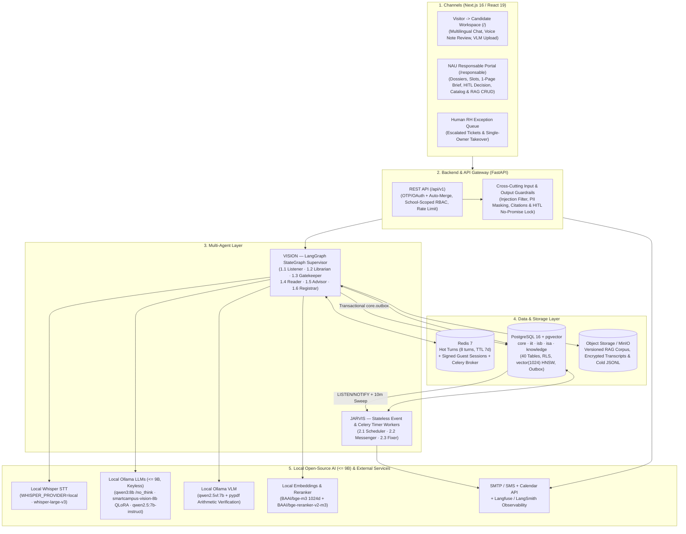

# SmartCampus AI — Global Technical Architecture (`SA-4`)

> **Status:** Sprint 1 + Sprint 2 Active Architecture (`SA-4` / `SA-69` / `20261127_0003`)  
> **Scope:** IIT and ISB (with ISA as an architectural extension within the NAU Private University ecosystem, Sfax)  
> **Pitch:** *"VISION talks, JARVIS follows up, humans decide: agents handle the volume, rules bound what they may do, and every recommendation is cited, measured and signed off by a person."*

---

## 1. Core Architectural Principles

1. **Progressive Access ("Give or Keep", `Visitor -> Candidate`):** Orientation, multilingual RAG Q&A, and declarative eligibility checks are open to every **Visitor** (`VISITOR` — prospective high-school students, university graduates, or parents/relatives inquiring for a candidate) without creating an account. Authentication (Email/SMS OTP or Google OAuth) promotes the user to **Candidate** (`CANDIDATE`), automatically merges the 7-day Redis session into PostgreSQL, and is required strictly before uploading an official transcript, saving/emailing a shortlist, or submitting pre-registration.
2. **Human-in-the-Loop (HITL) Admissions & School Ownership:** No AI agent, graph node, or tool may admit, waitlist, or reject a candidate (`ADMITTED | WAITLIST | REJECTED`). Only the school-scoped **NAU Responsable** (`RESPONSABLE` for `iit`, `isb`, or `isa`) signs the final admission decision and maintains the school's official catalog and RAG document corpus. Standalone `Direction` and `Platform Admin` UI portals are retired in favor of the unified `Responsable` portal (retained only as legacy SQL/RLS and root `/api/v1/catalog/schools` compatibility roles).
3. **Zero Invented Program Facts:** Tuition fees, admission deadlines, eligibility thresholds, and curricula are served strictly from PostgreSQL catalog tables (`core.program*`, `core.admission_campaign`) and cited `knowledge.chunks` (`pgvector` `vector(1024)`) passages — never fabricated from model weights.
4. **100% Local Open-Source AI (`<= 9B`, Keyless):** All generative, vision, embedding, reranking, and speech models run locally without proprietary cloud API dependencies (`qwen3:8b` `/no_think`, `smartcampus-vision-8b` QLoRA, `qwen2.5:7b-instruct`, `qwen2.5vl:7b`, `BAAI/bge-m3` `1024d`, `BAAI/bge-reranker-v2-m3`, local `whisper-large-v3`).
5. **Decoupled Orchestrators & Single Case Owner:** **VISION** (synchronous front-office) and **JARVIS** (asynchronous back-office) never call or import each other; VISION writes transactional events (`pre-inscription submitted`, `qcm_completed`) to `core.outbox`, and JARVIS reacts via event/timer workers. Each dossier obeys `owner in {JARVIS, RH:<user>}`, where **Human RH** takeover immediately halts automated reminders.

---

## 2. Five-Layer Global Architecture



---

## 3. Multi-Agent Hierarchy & Explicit Component Typing

Every runtime unit is explicitly typed so deterministic code and business rules are never conflated with probabilistic AI models:

| Unit | Role | Implementation Type |
| :--- | :--- | :--- |
| **VISION** | Front-office LangGraph `StateGraph` supervisor (steps 1–7 + parallel sign-up) | LLM supervisor |
| `1.1_Listener` | Local Whisper STT + language/dialect detection + Arabizi normalization + intent routing | LLM (+ Whisper STT + deterministic regex normalizer) |
| `1.2_Librarian` | Continuous program Q&A via progressive hybrid RAG (`bge-m3` `1024d` + `TSVECTOR` RRF + `bge-reranker-v2-m3` + CRAG) + SQL catalog tools | LLM + RAG |
| `1.3_Gatekeeper` | Conversational profile fact extraction (LLM) + deterministic eligibility & equivalence rules (YAML + PostgreSQL) | LLM + rules |
| `1.4_Reader` | Official Bac / Licence transcript extraction (`qwen2.5vl:7b`) + weighted average check + `< 0.85` confidence flags | VLM (+ `pypdf` / Pillow) |
| `1.5_Advisor` | Deterministic `score_compatibilite()` (academic + stated-interest features only) + comparative explanation of 2–3 tracks | code + LLM |
| `1.6_Registrar` | Pre-registration form pre-fill, INPDP consent check, vetted 5–10 question QCM, 1-page brief, and `core.outbox` emission | LLM (+ atomic SQL transactions) |
| **JARVIS** | Back-office orchestrator (step 8), stateless between domain events, Celery ETA timers, and 10-min reconciliation sweeps | Event / timer workers |
| `2.1_Scheduler` | Interview slot locking (`UNIQUE(responsable_id, start_time)` + `SELECT ... FOR UPDATE`, zero double-booking) | code |
| `2.2_Messenger` | Template-bounded T-24h / 24h / 48h reminders (`qwen2.5:7b-instruct`) & candidate reply classification (`confirm / move / cancel`) | LLM (template-bounded) |
| `2.3_Fixer` | Releases cancelled slots, 15-min waitlist hold to next 3 candidates, enforces `reschedules <= 2`, opens `core.rh_ticket` | rules + LLM |
| **Guardrail Node** | Input injection/trap filter, required RAG citations, PII masking, output language alignment, and `FORBIDDEN_AGENT_STATUSES` lock | rules + RAG grounding |

---

## 4. End-to-End Pipeline (`Visitor -> Candidate` + `NAU Responsable`)

1. **Phase 1 — Discover (`Visitor`, Anonymous, Redis 7-Day Sliding TTL):**
   - **Step 1 (Talk):** Text or reviewed voice note in French, Modern Standard Arabic (Fusha), Tunisian Derja, or Arabizi (`1.1_Listener`); low-confidence inputs (`< 0.45`) safely request a French reformulation without hallucinating.
   - **Step 2 (Ask & Build Profile):** Continuous cited RAG Q&A (`1.2_Librarian`) across official `iit.tn` and NAU documents while progressively capturing declared education facts (`1.3_Gatekeeper`).
   - **Step 3 (Check Eligibility):** Deterministic YAML and catalog prerequisite evaluation (`ELIGIBLE`, `BORDERLINE_TO_CONFIRM` routed for Responsable confirmation, or early `INELIGIBLE` with alternatives).
   - **Step 4 (Recommend 2–3 Tracks):** Transparent `score_compatibilite()` breakdown across IIT / ISB (and ISA extension) tracks (`1.5_Advisor`).
2. **Parallel Step — Seamless Sign-In (`Visitor -> Candidate`):**
   - Triggered voluntarily ("Save shortlist") or right before transcript upload / pre-registration (`AUTH_REQUIRED`).
   - `POST /api/v1/auth/otp/verify` or `POST /api/v1/auth/oauth/google` automatically merges the guest Redis session into PostgreSQL (`actor_stage = "CANDIDATE"`, `session_merged = true`, `turns_merged`), clears the guest cookie, and records explicit **INPDP Law 2004-63** consent (`POST /api/v1/auth/consent`).
3. **Phase 2 — Enrol (`Candidate`, Authenticated, PostgreSQL + Object Storage):**
   - **Step 5 (Pre-Registration & VLM Transcript):** Encrypted transcript storage + `qwen2.5vl:7b` extraction (`POST /api/v1/documents/extract-and-sync-transcript`), candidate confirmation of `< 0.85` fields (`RELEVE_CONFIRMATION`) or `MISMATCH_RH` escalation (`> 0.25` delta), and single-transaction write to `core` + `<school>.dossiers` + `core.outbox`.
   - **Step 6 (Targeted QCM & 1-Page Brief):** 5–10 vetted questions graded deterministically (`<school>.qcm_results`) + synthesized 1-page interviewer brief (`<school>.briefs`).
4. **Phase 3 — Follow Up (`JARVIS` & `Human RH`):**
   - **Step 7 (Scheduling & Exceptions):** Slot booking, idempotent reminders (`appointment_id + message_type`), max 2 reschedules, and automatic escalation (`DORMANT` at 72h, `NO_SHOW`, 3rd reschedule, or document mismatch) to `Human RH`.
5. **Phase 4 — Decide & Maintain Knowledge (`NAU Responsable`):**
   - **Step 8 (Interview & Signed Decision):** School-scoped `Responsable` conducts the interview, signs `ADMITTED | WAITLIST | REJECTED` in `<school>.decisions`, and maintains school programs, prerequisites, fees, campaigns, and RAG corpus versions.

---

## 5. Data Architecture, Official `iit.tn` Corpus & 3-Tier Memory

### 5.1 PostgreSQL 16 + `pgvector` Logical Isolation (Alembic `20261127_0003`)
- **`core`:** `school`, `program`, `program_prerequisite`, `program_fee`, `admission_campaign`, `accounts`, `roles`, `account_roles`, `guest_sessions`, `candidate`, `candidate_profile`, `declared_grades`, `consent`, `conversation_threads`, `document` (private candidate transcripts), `documents` (`CorpusDocument` official RAG master catalog), `document_versions`, `document_sync_jobs` (`embedding_model DEFAULT 'bge-m3'`), `document_sync_logs`, `shortlist`, `equivalence_requests`, `slot`, `appointment`, `appointment_event`, `rh_ticket`, `outbox`, `audit_log`.
- **`iit` / `isb` / `isa`:** School-isolated `dossiers`, `qcm_bank`, `qcm_results`, `briefs`, and `decisions` enforced by PostgreSQL **Row-Level Security (RLS)** and dedicated database roles (`authenticated_student`, `nau_responsable`, `human_rh`).
- **`knowledge`:** `knowledge.chunks` storing `embedding vector(1024)` (`BAAI/bge-m3`) with HNSW cosine index (`m = 16, ef_construction = 64`), persisted `content_tsv TSVECTOR` GIN index for hybrid RRF search, and citation metadata (`school`, `program`, `source_document`, `section_ref`).

### 5.2 Official Scraped `https://iit.tn/` Corpus (`SA-56`)
- `backend/data/corpus/iit/` ships **42 official scraped Markdown documents** + `manifest.json` covering IIT engineering cycles, licences, preparatory tracks, academic life, and admission procedures (`backend/scripts/scrape_iit_tn.py`, `robots.txt`-compliant).
- `backend/scripts/sync_iit_corpus.py` registers and versions all 42 documents idempotently into `core.documents`, `core.document_versions`, and `core.document_sync_jobs` using SHA-256 deduplication.

### 5.3 3-Tier Conversation Memory
- **Hot (Redis 7):** Last 8 turns (`<= 16` messages) + active session state (`TTL = 7 days` sliding, strictly partitioned across `guest`, `candidate`, and `account` scopes).
- **Warm (PostgreSQL 16):** Typed `core.candidate_profile` facts + rolling summary (`<= 300 tokens`, refreshed every 6 turns) + latest LangGraph thread checkpoint.
- **Cold (Object Storage / MinIO):** Compressed `.jsonl.gz` transcripts and encrypted candidate grade sheets for audit and evaluation.

---

## 6. Repository Layout & Empirical ML Workflow

```text
.
├── architecture/          # System architecture, RBAC, REST API contract, DB schemas & evaluation specs
├── backend/               # FastAPI app, LangGraph VISION supervisor, Alembic migrations, corpus & pytest suite
│   ├── data/corpus/iit/   # 42 official https://iit.tn/ Markdown documents + manifest.json
│   └── scripts/           # scrape_iit_tn.py, sync_iit_corpus.py, seed_db.py, verify_schema.py, benchmarks
├── frontend/              # Next.js / React workspace: Visitor->Candidate (/) & NAU Responsable (/responsable)
├── ml/colab/              # Google Colab Pro notebooks (01 Zero/Few-Shot RAG, 02 QLoRA GGUF, 03 VLM & Whisper)
├── docker/postgres/       # PostgreSQL 16 + pgvector schema & RLS bootstrap
└── docker-compose.yml     # Local orchestration: PostgreSQL 16, Redis 7, FastAPI backend, Next.js frontend
```
