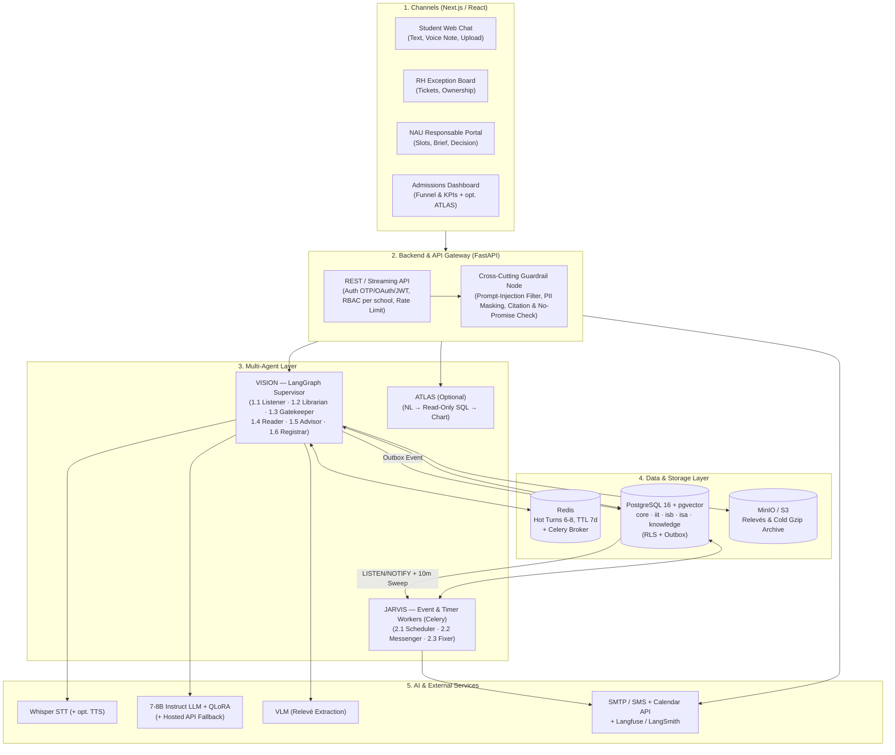

# SmartCampus AI — Global Technical Architecture (`SA-4`)

> **Status:** Sprint 1 — Architecture Baseline (`#1` / `SA-4`)  
> **Sources:** `Docs/Projet_IAG_p3_26_27.pdf`, `Docs/SC_V4.pdf`, `Docs/SmartCampus_AI_Pipeline_v3.png`, `Docs/SmartCampus_AI_Use_Case_v4.puml`  
> **Pitch:** *"VISION talks, JARVIS follows up, humans decide: agents handle the volume, rules bound what they may do, and every recommendation is cited, measured and signed off by a person."*

---

## 1. Core Architectural Principles

1. **Auth Rule ("Give or Keep"):** Orientation and Q&A are frictionless and anonymous. Authentication (Google OAuth / Email OTP / JWT) is required only at the first of: uploading an official *relevé*, saving/emailing a shortlist, or starting pre-inscription/booking.
2. **Human-in-the-Loop (HITL) Admissions:** No AI agent or tool may admit, waitlist, or reject a candidate. Only the **NAU Responsable** (per school: IIT / ISB / ISA) signs the final admission decision.
3. **Zero Invented Program Facts:** Fees, deadlines, and official rules are served strictly from PostgreSQL tables and cited `pgvector` RAG chunks—never generated from model weights.
4. **Decoupled Orchestrators:** **VISION** (front-office) and **JARVIS** (back-office) never call each other directly; VISION writes a `pre-inscription submitted` event to the PostgreSQL `outbox` table, and JARVIS reacts asynchronously.
5. **One Owner per Case:** `owner ∈ {JARVIS, RH:<user>}`. Human RH takeover immediately halts automated JARVIS messages.

---

## 2. Five-Layer Global Architecture



---

## 3. Multi-Agent Hierarchy & Component Types

Every unit is explicitly typed to distinguish probabilistic AI models from deterministic code and rules:

| Unit | Role | Implementation Type |
| :--- | :--- | :--- |
| **VISION** | Front-office LangGraph supervisor (steps 1–6 + sign-up trigger) | LLM supervisor |
| `1.1 Listener` | Voice STT + Arabizi normalization → clean text & intent | LLM (+ Whisper STT + regex map) |
| `1.2 Librarian` | Program Q&A via hybrid search (BM25 + pgvector) with citations | LLM + RAG |
| `1.3 Gatekeeper` | Profile extraction (LLM) + eligibility evaluation (YAML rules) | LLM + rules |
| `1.4 Reader` | *Relevé de notes* extraction → structured JSON + field confidence | VLM (+ OpenCV) |
| `1.5 Advisor` | `score_compatibilite()` weights + explained 2–3 track shortlist | code + LLM |
| `1.6 Registrar` | Pre-inscription form pre-fill, adaptive QCM (from vetted bank), 1-page brief | LLM |
| **JARVIS** | Back-office orchestrator (step 7), stateless between event/timer triggers | — |
| `2.1 Scheduler` | Slot management & booking (`SELECT … FOR UPDATE`, no double-booking) | code |
| `2.2 Messenger` | Template-bound T-24h reminders & reply understanding (confirm/move/cancel) | LLM |
| `2.3 Fixer` | Releases cancelled slots, waitlist auto-fill (15-min hold), opens RH tickets | rules + LLM |
| **ATLAS** *(opt.)* | Direction NL questions → read-only SQL views → chart + summary | LLM |
| **Guardrail Node** | Citations required for facts, no admission promises, no invented fees, language match | cross-cutting |

---

## 4. End-to-End Pipeline (8 Steps + Parallel Sign-Up)

1. **Discover (Anonymous — Redis 7 d TTL):**
   - **Step 1:** Multimodal chat in French, Tunisian Derja, or Arabizi (`VISION 1.1`).
   - **Step 2:** Continuous RAG Q&A on programs (`VISION 1.2`) + profile building (`VISION 1.3`).
   - **Step 3:** Early eligibility check via YAML rule engine (`VISION 1.3`).
   - **Step 4:** Compatibility scoring & 2–3 recommended tracks (`VISION 1.5`).
2. **Parallel Step — Sign-Up:** Available anytime in steps 1–5; mandatory before *relevé* upload. Merges anonymous Redis session + declared profile into PostgreSQL.
3. **Enrol (Authenticated):**
   - **Step 5:** Pre-inscription form, *relevé* upload + VLM OCR pre-fill + user confirmation, explicit consent, atomic transaction into `core` + school schema (`VISION 1.4 / 1.6`).
   - **Step 6:** Adaptive short QCM (5–10 vetted questions) + 1-page interviewer brief (`VISION 1.6`).
4. **Follow-Up & Decide:**
   - **Step 7:** Event/timer-driven scheduling, T-24h reminders, max 2 auto-reschedules, RH escalation (`JARVIS 2.1–2.3`).
   - **Step 8:** Interview & signed final decision (`ADMITTED | WAITLIST | REJECTED`) by **NAU Responsable**; student notified via email + app.

---

## 5. Data, Schemas & 3-Tier Memory

### PostgreSQL 16 + `pgvector` Logical Isolation
- **`core`**: `accounts`, `candidate`, `candidate_profile`, `consent`, `document`, `shortlist`, `slot`, `appointment`, `appointment_event`, `rh_ticket`, `outbox`, `audit`.
- **`iit` / `isb` / `isa`**: School-isolated `dossiers`, `qcm`, `briefs`, `decisions` protected by **Row-Level Security (RLS)** and separate DB roles.
- **`knowledge`**: `pgvector` chunks with metadata (`school`, `program`, `source`, `date`).

### 3-Tier Conversation Memory
- **Hot (Redis):** Current graph state + last 6–8 turns (TTL 7 days for anonymous sessions, refreshed on activity).
- **Warm (PostgreSQL):** Typed `candidate_profile` facts + rolling summary (≤ 300 tokens, updated every 6 turns) + latest LangGraph checkpoint.
- **Cold (MinIO / S3):** Gzipped JSONL transcripts and uploaded *relevés* for audit and evaluation.

---

## 6. Target Repository Layout & Open Decisions

```text
SmartCampus_NightAgents/
├── backend/          # FastAPI app, LangGraph VISION, Celery JARVIS, Alembic (SA-7)
├── frontend/         # Next.js / React chat, RH board, Responsable & Direction portals (SA-8)
├── docker-compose.yml# Local orchestration: FastAPI, Next.js, Postgres+pgvector, Redis, MinIO (SA-9)
├── docs/             # Architecture, API specs, ER diagrams
├── scripts/          # Backlog & operational scripts
└── .github/          # CI workflows (ci.yml) & issue/PR templates
```

### Open Questions to Finalize with Team / Administration
- `TODO(open-question U5/U6)`: Exact 7–8B open-source LLM, VLM, embedding model, Whisper size, and hosted API fallback provider.
- `TODO(open-question S1)`: Confirm whether **ISA** is in active Sprint scope or remains an announced extension.
- `TODO(open-question U11)`: Target deployment environment (local Docker vs cloud GPU).

