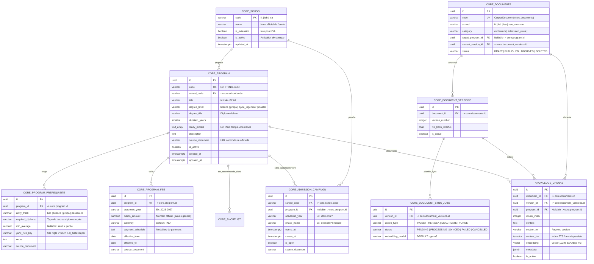

# SmartCampus AI — Conception des Tables du Catalogue IIT / ISB (`SA-12` / `SA-20` / `SA-21`)

> **Tâche :** `[SA-12]` Concevoir les tables du catalogue (IIT/ISB + extension ISA) — Story `SA-11: Modèle Relationnel`  
> **Responsable :** Mehdi Zouari (Team Leader / `@mahdizouari`)  
> **Dépendances :** [architecture.md](./architecture.md) (`SA-4`) · [api_contract.md](./api_contract.md) & [rbac_matrix.md](./rbac_matrix.md) (`SA-5`) · [document_management_and_sync.md](./document_management_and_sync.md) (`SA-14` / `SA-56`)  
> **Implémentation active :** `backend/app/models/catalog.py`, `backend/app/models/documents_rag.py`, `backend/app/api/v1/endpoints/catalog.py`, `backend/app/api/v1/endpoints/catalog_management.py`, révision Alembic `20261127_0003`

---

## 1. Objectif & Principes de Conception

Ce modèle relationnel définit **la source de vérité unique** pour le catalogue académique des écoles **IIT**, **ISB** et l'extension architecturale **ISA** au sein de l'écosystème NAU.

### Règles d'Ingénierie Non Négociables
1. **Zéro fait inventé par les LLMs :** Les intitulés officiels, prérequis, frais de scolarité et dates limites de campagne sont **lus exclusivement depuis PostgreSQL** (`core.program*`, `core.admission_campaign`) et les passages officiels indexés dans `knowledge.chunks` (`vector(1024)` `BAAI/bge-m3` + `TSVECTOR`) — jamais générés librement à partir des poids d'un modèle.
2. **Traçabilité obligatoire des sources :** Chaque enregistrement du catalogue référence son document ou URL officiel (`source_document`) afin d'alimenter les citations vérifiées par le `Guardrail Node` et `VISION 1.2_Librarian`. Toute valeur de démonstration non encore publiée dans la brochure officielle porte explicitement un marqueur `TODO(corpus): ...`.
3. **Administration par école confiée au `Responsable` :** Chaque **`Responsable`** (`NAU Responsable`, `role = "responsable"` cloisonné par `school_scope` `iit | isb | isa`) dispose des droits CRUD complets sur les formations, prérequis, frais et campagnes de son établissement (`require_catalog_manager`), tandis que la création/modification du registre racine d'écoles (`/api/v1/catalog/schools`) reste protégée par `require_catalog_admin`.

---

## 2. Diagramme Entité-Association (ER — Aligné Modèles SQLAlchemy & Alembic `20261127_0003`)

---

## 3. Spécification Détaillée des Tables (PostgreSQL 16 + `pgvector`)

### 3.1 Schéma `core` — Référentiel Catalogue, Frais & Campagnes

#### `core.school` (`School`)
Référentiel des établissements NAU supportés (`iit`, `isb`, et extension `isa`).

| Colonne | Type SQL | Contraintes | Description |
| :--- | :--- | :--- | :--- |
| `code` | `VARCHAR(16)` | `PRIMARY KEY`, `CHECK (code IN ('iit', 'isb', 'isa'))` | Code canonique aligné sur `SchoolCode` |
| `name` | `VARCHAR(150)` | `NOT NULL` | Nom officiel de l'établissement |
| `is_extension` | `BOOLEAN` | `NOT NULL DEFAULT false` | `true` pour l'extension architecturale `isa` |
| `is_active` | `BOOLEAN` | `NOT NULL DEFAULT true` | Active/désactive l'exposition publique dans le catalogue |
| `created_at` | `TIMESTAMPTZ` | `NOT NULL DEFAULT now()` | Date de création |
| `updated_at` | `TIMESTAMPTZ` | `NOT NULL DEFAULT now()` | Dernière mise à jour |

---

#### `core.program` (`Program`)
Table centrale des formations/filières, cible de `core.shortlist.program_id` et de `knowledge.chunks.program_id`.

| Colonne | Type SQL | Contraintes | Description |
| :--- | :--- | :--- | :--- |
| `id` | `UUID` | `PRIMARY KEY DEFAULT gen_random_uuid()` | Identifiant interne stable |
| `code` | `VARCHAR(40)` | `UNIQUE NOT NULL` | Code métier lisible (ex. `IIT-ING-GLID`, accepté par `/catalog/programs/{id}`) |
| `school_code` | `VARCHAR(16)` | `NOT NULL REFERENCES core.school(code)` | École de rattachement (`iit` \| `isb` \| `isa`) |
| `title` | `VARCHAR(200)` | `NOT NULL` | Intitulé officiel de la filière |
| `degree_level` | `VARCHAR(32)` | `NOT NULL CHECK (degree_level IN ('licence', 'prepa', 'cycle_ingenieur', 'master'))` | Niveau pour filtrage (`GET /catalog/programs?degree_level=...`) |
| `degree_title` | `VARCHAR(150)` | `NOT NULL` | Intitulé du diplôme délivré |
| `duration_years` | `SMALLINT` | `NOT NULL CHECK (duration_years BETWEEN 1 AND 6)` | Durée officielle en années |
| `study_modes` | `TEXT[]` | `NOT NULL DEFAULT '{}'` | Modalités d'études |
| `description` | `TEXT` | `NOT NULL DEFAULT ''` | Présentation officielle de la formation |
| `source_document` | `VARCHAR(255)` | `NOT NULL` | URL `https://iit.tn/...` ou référence du document source |
| `is_active` | `BOOLEAN` | `NOT NULL DEFAULT true` | Visibilité publique dans le catalogue |
| `created_at` | `TIMESTAMPTZ` | `NOT NULL DEFAULT now()` | Horodatage création |
| `updated_at` | `TIMESTAMPTZ` | `NOT NULL DEFAULT now()` | Horodatage modification |

---

#### `core.program_prerequisite` (`ProgramPrerequisite`)
Conditions d'accès structurées par voie d'entrée (Bac, Licence, Prépa, Passerelle) consommées par `VISION 1.3_Gatekeeper`.

| Colonne | Type SQL | Contraintes | Description |
| :--- | :--- | :--- | :--- |
| `id` | `UUID` | `PRIMARY KEY DEFAULT gen_random_uuid()` | Identifiant |
| `program_id` | `UUID` | `NOT NULL REFERENCES core.program(id) ON DELETE CASCADE` | Filière cible |
| `entry_track` | `VARCHAR(32)` | `NOT NULL CHECK (entry_track IN ('bac', 'licence', 'prepa', 'passerelle'))` | Voie d'entrée du candidat |
| `required_diploma` | `VARCHAR(150)` | `NOT NULL` | Diplôme ou section de Bac admissible |
| `min_average` | `NUMERIC(4,2)` | `NULL CHECK (min_average BETWEEN 0 AND 20)` | Seuil minimal officiel si publié (`NULL` sinon) |
| `yaml_rule_key` | `VARCHAR(100)` | `NULL` | Référence vers la règle YAML exécutée par `1.3_Gatekeeper` |
| `notes` | `TEXT` | `NOT NULL DEFAULT ''` | Précisions ou équivalences à confirmer par le `Responsable` |
| `source_document` | `VARCHAR(255)` | `NOT NULL` | Source officielle |

---

#### `core.program_fee` (`ProgramFee`)
Frais de scolarité par année universitaire servis par PostgreSQL (jamais codés en dur dans les prompts).

| Colonne | Type SQL | Contraintes | Description |
| :--- | :--- | :--- | :--- |
| `id` | `UUID` | `PRIMARY KEY DEFAULT gen_random_uuid()` | Identifiant |
| `program_id` | `UUID` | `NOT NULL REFERENCES core.program(id) ON DELETE CASCADE` | Filière concernée |
| `academic_year` | `VARCHAR(16)` | `NOT NULL` | Ex. `2026-2027` |
| `tuition_amount` | `NUMERIC(10,2)` | `NOT NULL CHECK (tuition_amount >= 0)` | Montant annuel (`UNIQUE (program_id, academic_year, effective_from)`) |
| `currency` | `VARCHAR(8)` | `NOT NULL DEFAULT 'TND'` | Devise |
| `payment_schedule` | `TEXT` | `NOT NULL DEFAULT ''` | Modalités et échéancier |
| `effective_from` | `DATE` | `NOT NULL` | Début de validité |
| `effective_to` | `DATE` | `NULL` | Fin de validité |
| `source_document` | `VARCHAR(255)` | `NOT NULL` | Source officielle (ou `TODO(corpus): demo_seed_placeholder` en environnement de démo) |

---

#### `core.admission_campaign` (`AdmissionCampaign`)
Calendrier d'ouverture et de clôture des candidatures par établissement (et optionnellement par filière).

| Colonne | Type SQL | Contraintes | Description |
| :--- | :--- | :--- | :--- |
| `id` | `UUID` | `PRIMARY KEY DEFAULT gen_random_uuid()` | Identifiant |
| `school_code` | `VARCHAR(16)` | `NOT NULL REFERENCES core.school(code)` | École concernée |
| `program_id` | `UUID` | `NULL REFERENCES core.program(id) ON DELETE CASCADE` | `NULL` = campagne globale à l'école |
| `academic_year` | `VARCHAR(16)` | `NOT NULL` | Année universitaire (ex. `2026-2027`) |
| `phase_name` | `VARCHAR(100)` | `NOT NULL` | Ex. `Session Principale` |
| `opens_at` | `TIMESTAMPTZ` | `NOT NULL` | Date d'ouverture |
| `closes_at` | `TIMESTAMPTZ` | `NOT NULL CHECK (closes_at > opens_at)` | Date de clôture |
| `is_open` | `BOOLEAN` | `NOT NULL DEFAULT true` | Statut actif |
| `source_document` | `VARCHAR(255)` | `NOT NULL` | Source officielle |

---

### 3.2 Articulation avec le Corpus RAG Unifié (`core.documents` & `knowledge.chunks`)

L'implémentation ORM (`backend/app/models/documents_rag.py`) et la migration `20261127_0003` unifient les tables documentaires et vectorielles avec le catalogue :
* **`core.documents` (`CorpusDocument`) & `core.document_versions` (`CorpusDocumentVersion`) :** Stockent les métadonnées, la filière cible optionnelle (`target_program_id -> core.program.id`) et l'historique des versions `SHA-256`, suivis par `core.document_sync_jobs` (`embedding_model DEFAULT 'bge-m3'`).
* **`knowledge.chunks` (`KnowledgeChunk`) :** Stocke chaque segment cité avec `document_id -> core.documents.id`, `version_id -> core.document_versions.id`, `program_id -> core.program.id`, `content_tsv TSVECTOR` (GIN) et **`embedding vector(1024)`** (`BAAI/bge-m3`, index HNSW `m = 16, ef_construction = 64`).

---

## 4. Indexation, Performance & Sécurité (RBAC / Isolation par École)

### 4.1 Index PostgreSQL Actifs (`SA-17` & `20261127_0003`)
* `CREATE INDEX idx_program_school_level ON core.program (school_code, degree_level) WHERE is_active = true;`
* `CREATE INDEX idx_prereq_program_track ON core.program_prerequisite (program_id, entry_track);`
* `CREATE INDEX idx_fee_program_year ON core.program_fee (program_id, academic_year);`
* `CREATE INDEX idx_campaign_school_open ON core.admission_campaign (school_code, is_open, closes_at);`
* `CREATE INDEX idx_knowledge_chunks_tsv ON knowledge.chunks USING gin (content_tsv);`
* `CREATE INDEX idx_knowledge_chunks_embedding_hnsw ON knowledge.chunks USING hnsw (embedding vector_cosine_ops) WITH (m = 16, ef_construction = 64);`

### 4.2 Droits d'Accès (`rbac_matrix.md` & `catalog_management.py`)
* **Lecture publique (`GET /api/v1/catalog/*` sur lignes actives) :** Ouverte à `VISITOR`, `CANDIDATE`, `RESPONSABLE`, `HUMAN_RH`, ainsi qu'aux outils en lecture seule de `VISION` (`1.2_Librarian`, `1.5_Advisor`).
* **Écriture métier cloisonnée par école (`require_catalog_manager`) :** Le **`RESPONSABLE`** (`role = "responsable"`, `school_scope IN ('iit', 'isb', 'isa')`) dispose du **CRUD complet sur les formations (`programs`), prérequis (`prerequisites`), frais (`fees`) et campagnes (`campaigns`) de sa propre école** (toute mutation sur une autre école est rejetée avec `403 Forbidden`).
* **Registre racine d'écoles (`require_catalog_admin`) :** Seules les routes techniques `POST /api/v1/catalog/schools` et `PATCH /api/v1/catalog/schools/{school_code}` restent réservées au rôle racine `admin`. Le rôle `direction` et les agents IA (`VISION` / `JARVIS`) n'ont aucun droit d'écriture sur le catalogue (`403 Forbidden`).

---

## 5. Contrat d'Intégration avec les Modules de la Plateforme

| Tâche / Module | Intégration avec le Catalogue |
| :--- | :--- |
| **`SA-13` (`users.py`)** | `core.shortlist.program_id` et `core.equivalence_requests.target_program_id` référencent `core.program(id)`. |
| **`SA-14` / `SA-56` (`documents_rag.py`)** | `core.documents.target_program_id` et `knowledge.chunks.program_id` référencent `core.program(id)` ; `<school>.dossiers` référence la filière choisie. |
| **`SA-17` & `20261127_0003`** | Migrations Alembic déployant les 40 tables, les 79 clés étrangères, RLS et `knowledge.chunks.embedding vector(1024)`. |
| **`SA-18` (`seed_db.py`)** | Alimente de façon idempotente `core.school` (`iit`, `isb`, `isa`) et les 16 formations de référence. |
| **`SA-20` (`catalog_management.py`)** | Routes CRUD `require_catalog_manager` (`Responsable` cloisonné par école + `admin`) sur `programs`, `prerequisites`, `fees` et `campaigns`. |
| **`SA-21` (`catalog.py`)** | Routes publiques `GET /api/v1/catalog/schools`, `/programs` (`{ total, items }`), `/programs/compare`, `/programs/{id}`, `/prerequisites`, `/fees` et `/campaigns`. |

---

## 6. Alimentation via le Corpus Officiel `https://iit.tn/` (`SA-56`)

* **Pages officielles scrapées :** `backend/data/corpus/iit/` regroupe **42 documents Markdown officiels** extraits depuis `https://iit.tn/` (`backend/scripts/scrape_iit_tn.py`) et synchronisés de manière idempotente dans `core.documents`, `core.document_versions` et `core.document_sync_jobs` via `backend/scripts/sync_iit_corpus.py`.
* **Garde-fou anti-invention sur les données de démonstration :** Dans `backend/scripts/seed_db.py`, toute valeur de démonstration non publiée explicitement sur `https://iit.tn/` (ex. montants tarifaires indicatifs de test) est marquée `TODO(corpus): demo_seed_placeholder` dans `source_document` afin de ne jamais être présentée comme un tarif officiel vérifié.
* **Extension `isa` :** Configurée dynamiquement via `core.school.is_extension = true` et `core.school.is_active`, sans aucune modification de schéma requise.
