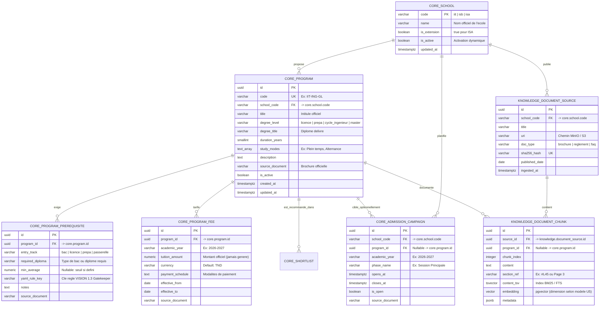

# SmartCampus AI — Conception des Tables du Catalogue IIT / ISB (`SA-12`)

> **Tâche :** `[SA-12]` Concevoir les tables du catalogue (IIT/ISB) — Issue GitHub `#2` · Story `SA-11: Modèle Relationnel`  
> **Responsable :** Mehdi Zouari (Team Leader / `@mahdizouari`)  
> **Dépendances :** [architecture.md](./architecture.md) (`SA-4`) · [api_contract.md](./api_contract.md) & [rbac_matrix.md](./rbac_matrix.md) (`SA-5`)  
> **Consommateurs directs :** `SA-17` (Migrations SQL — Moataz), `SA-20` (API gestion catalogue — Mehdi), `SA-21` (API consultation catalogue — Youssef)

---

## 1. Objectif & Principes de Conception

Ce modèle relationnel définit **la source de vérité unique** pour le catalogue académique des écoles **IIT**, **ISB** et l'extension prévue **ISA** au sein de l'écosystème NAU.

### Règles non négociables (`SC V4`)
1. **Zéro fait inventé par les LLMs :** Les intitulés officiels, prérequis, frais de scolarité et dates limites de campagne sont **lus exclusivement depuis PostgreSQL** et les passages indexés dans `knowledge` (jamais générés librement par un modèle).
2. **Traçabilité obligatoire des sources :** Chaque enregistrement du catalogue référence son document officiel (`source_document`, `source_version`) afin d'alimenter les citations exigées par le `Guardrail Node` et `VISION 1.2 Librarian`.
3. **Schéma logique unifié :** Conformément à `SA-4`, les tables de référence publiques résident dans le schéma `core` (liées aux candidatures via `core.shortlist.program_id`) et les chunks vectoriels/textuels pour le RAG dans le schéma `knowledge`.
4. **Statut de proposition :** Les tables ci-dessous étendent le noyau minimal de `SC V4` (les données réelles seront injectées lors de l'ingestion du corpus officiel — voir §6 `TODO`).

---

## 2. Diagramme Entité-Association (ER)

---

## 3. Spécification Détaillée des Tables (Cible PostgreSQL 16 + `pgvector`)

### 3.1 Schéma `core` — Référentiel Catalogue, Frais & Campagnes

#### `core.school`
Référentiel des établissements NAU supportés (`iit`, `isb`, et extension `isa`).

| Colonne | Type SQL | Contraintes | Description |
| :--- | :--- | :--- | :--- |
| `code` | `VARCHAR(16)` | `PRIMARY KEY`, `CHECK (code IN ('iit', 'isb', 'isa'))` | Code canonique aligné sur `SchoolCode` (`api_contract.md`) |
| `name` | `VARCHAR(150)` | `NOT NULL` | Nom officiel de l'établissement |
| `is_extension` | `BOOLEAN` | `NOT NULL DEFAULT false` | `true` pour `isa` tant que son périmètre est en extension |
| `is_active` | `BOOLEAN` | `NOT NULL DEFAULT true` | Active/désactive l'exposition publique dans le catalogue |
| `created_at` | `TIMESTAMPTZ` | `NOT NULL DEFAULT now()` | Date de création |
| `updated_at` | `TIMESTAMPTZ` | `NOT NULL DEFAULT now()` | Dernière mise à jour |

---

#### `core.program`
Table centrale des formations/filières. C'est la cible de la clé étrangère `core.shortlist.program_id` et la source directe des endpoints `/api/v1/catalog/programs`.

| Colonne | Type SQL | Contraintes | Description |
| :--- | :--- | :--- | :--- |
| `id` | `UUID` | `PRIMARY KEY DEFAULT gen_random_uuid()` | Identifiant interne stable |
| `code` | `VARCHAR(40)` | `UNIQUE NOT NULL` | Code métier lisible (ex. `IIT-ING-GL`, aligné avec `program_id` front/API) |
| `school_code` | `VARCHAR(16)` | `NOT NULL REFERENCES core.school(code)` | École de rattachement (`iit` \| `isb` \| `isa`) |
| `title` | `VARCHAR(200)` | `NOT NULL` | Intitulé officiel de la filière |
| `degree_level` | `VARCHAR(32)` | `NOT NULL CHECK (degree_level IN ('licence', 'prepa', 'cycle_ingenieur', 'master'))` | Niveau pour filtrage (`GET /catalog/programs?degree_level=...`) |
| `degree_title` | `VARCHAR(150)` | `NOT NULL` | Intitulé du diplôme délivré |
| `duration_years` | `SMALLINT` | `NOT NULL CHECK (duration_years BETWEEN 1 AND 6)` | Durée en années |
| `study_modes` | `TEXT[]` | `NOT NULL DEFAULT '{}'` | Modalités (ex. `{'Plein temps'}`, `{'Alternance'}`) |
| `description` | `TEXT` | `NOT NULL DEFAULT ''` | Résumé officiel de la formation |
| `source_document` | `VARCHAR(255)` | `NOT NULL` | Nom/référence du document officiel source |
| `is_active` | `BOOLEAN` | `NOT NULL DEFAULT true` | Visibilité dans le catalogue |
| `created_at` | `TIMESTAMPTZ` | `NOT NULL DEFAULT now()` | Horodatage création |
| `updated_at` | `TIMESTAMPTZ` | `NOT NULL DEFAULT now()` | Horodatage modification |

---

#### `core.program_prerequisite`
Stocke les conditions d'accès structurées par voie d'entrée (Bac, Licence, Prépa, Passerelle) et relie chaque formation aux règles YAML de `VISION 1.3 Gatekeeper`.

| Colonne | Type SQL | Contraintes | Description |
| :--- | :--- | :--- | :--- |
| `id` | `UUID` | `PRIMARY KEY DEFAULT gen_random_uuid()` | Identifiant |
| `program_id` | `UUID` | `NOT NULL REFERENCES core.program(id) ON DELETE CASCADE` | Filière cible |
| `entry_track` | `VARCHAR(32)` | `NOT NULL CHECK (entry_track IN ('bac', 'licence', 'prepa', 'passerelle'))` | Parcours d'origine du candidat |
| `required_diploma` | `VARCHAR(150)` | `NOT NULL` | Diplôme ou section de Bac admissible |
| `min_average` | `NUMERIC(4,2)` | `NULL CHECK (min_average BETWEEN 0 AND 20)` | Seuil minimal officiel si applicable (`NULL` si non publié) |
| `yaml_rule_key` | `VARCHAR(100)` | `NULL` | Référence vers la règle YAML exécutée par `1.3 Gatekeeper` |
| `notes` | `TEXT` | `NOT NULL DEFAULT ''` | Précisions / équivalences à confirmer par Responsable |
| `source_document` | `VARCHAR(255)` | `NOT NULL` | Source officielle |

---

#### `core.program_fee`
Stocke les frais de scolarité officiels par année universitaire. Aucun tarif ne doit être codé en dur dans un prompt LLM.

| Colonne | Type SQL | Contraintes | Description |
| :--- | :--- | :--- | :--- |
| `id` | `UUID` | `PRIMARY KEY DEFAULT gen_random_uuid()` | Identifiant |
| `program_id` | `UUID` | `NOT NULL REFERENCES core.program(id) ON DELETE CASCADE` | Filière concernée |
| `academic_year` | `VARCHAR(16)` | `NOT NULL` | Ex. `2026-2027` |
| `tuition_amount` | `NUMERIC(10,2)` | `NOT NULL CHECK (tuition_amount >= 0)` | Montant annuel officiel |
| `currency` | `VARCHAR(8)` | `NOT NULL DEFAULT 'TND'` | Devise |
| `payment_schedule` | `TEXT` | `NOT NULL DEFAULT ''` | Échéancier / modalités |
| `effective_from` | `DATE` | `NOT NULL` | Date de début de validité |
| `effective_to` | `DATE` | `NULL` | Date de fin de validité |
| `source_document` | `VARCHAR(255)` | `NOT NULL` | Source officielle |

*Contrainte d'unicité proposée :* `UNIQUE (program_id, academic_year, effective_from)`.

---

#### `core.admission_campaign`
Calendrier officiel d'ouverture et de clôture des candidatures par école (et optionnellement par filière).

| Colonne | Type SQL | Contraintes | Description |
| :--- | :--- | :--- | :--- |
| `id` | `UUID` | `PRIMARY KEY DEFAULT gen_random_uuid()` | Identifiant |
| `school_code` | `VARCHAR(16)` | `NOT NULL REFERENCES core.school(code)` | École concernée |
| `program_id` | `UUID` | `NULL REFERENCES core.program(id) ON DELETE CASCADE` | `NULL` = s'applique à toute l'école |
| `academic_year` | `VARCHAR(16)` | `NOT NULL` | Année universitaire (ex. `2026-2027`) |
| `phase_name` | `VARCHAR(100)` | `NOT NULL` | Ex. `Session Principale`, `Rattrapage` |
| `opens_at` | `TIMESTAMPTZ` | `NOT NULL` | Ouverture des préinscriptions |
| `closes_at` | `TIMESTAMPTZ` | `NOT NULL CHECK (closes_at > opens_at)` | Date limite officielle |
| `is_open` | `BOOLEAN` | `NOT NULL DEFAULT true` | Statut administratif courant |
| `source_document` | `VARCHAR(255)` | `NOT NULL` | Source officielle |

---

### 3.2 Schéma `knowledge` — Corpus Officiel & Indexation RAG (`pgvector`)

#### `knowledge.document_source`
Métadonnées des documents sources ingérés (brochures, règlements, FAQ) stockés dans MinIO.

| Colonne | Type SQL | Contraintes | Description |
| :--- | :--- | :--- | :--- |
| `id` | `UUID` | `PRIMARY KEY DEFAULT gen_random_uuid()` | Identifiant du document |
| `school_code` | `VARCHAR(16)` | `NOT NULL REFERENCES core.school(code)` | École propriétaire du document |
| `title` | `VARCHAR(255)` | `NOT NULL` | Titre lisible (utilisé dans les citations) |
| `uri` | `TEXT` | `NOT NULL` | Emplacement MinIO / S3 |
| `doc_type` | `VARCHAR(32)` | `NOT NULL CHECK (doc_type IN ('brochure', 'reglement', 'faq', 'programme'))` | Catégorie documentaire |
| `sha256_hash` | `CHAR(64)` | `UNIQUE NOT NULL` | Déduplication à l'ingestion |
| `published_date` | `DATE` | `NULL` | Date officielle de publication |
| `ingested_at` | `TIMESTAMPTZ` | `NOT NULL DEFAULT now()` | Date d'indexation |

---

#### `knowledge.document_chunk`
Segments indexés pour la recherche hybride (BM25 full-text + similarité vectorielle `pgvector`) de `VISION 1.2 Librarian`.

| Colonne | Type SQL | Contraintes | Description |
| :--- | :--- | :--- | :--- |
| `id` | `UUID` | `PRIMARY KEY DEFAULT gen_random_uuid()` | Identifiant du chunk |
| `source_id` | `UUID` | `NOT NULL REFERENCES knowledge.document_source(id) ON DELETE CASCADE` | Document parent |
| `program_id` | `UUID` | `NULL REFERENCES core.program(id) ON DELETE SET NULL` | Lien optionnel vers une filière précise |
| `chunk_index` | `INTEGER` | `NOT NULL` | Position séquentielle dans le document |
| `content` | `TEXT` | `NOT NULL` | Texte brut du passage cité |
| `section_ref` | `VARCHAR(100)` | `NULL` | Page ou ancre (ex. `#L45` pour les citations API) |
| `content_tsv` | `TSVECTOR` | `GENERATED ALWAYS AS (to_tsvector('french', content)) STORED` | Vecteur lexical pour recherche hybride BM25 |
| `embedding` | `VECTOR` | `NOT NULL` *(dimension à fixer selon `TODO U5`)* | Embedding sémantique `pgvector` |
| `metadata` | `JSONB` | `NOT NULL DEFAULT '{}'` | Métadonnées additionnelles (langue, tags) |

---

## 4. Indexation, Performance & Sécurité (RBAC / RLS)

### 4.1 Index recommandés (`SA-17`)
* `CREATE INDEX idx_program_school_level ON core.program (school_code, degree_level) WHERE is_active = true;`
* `CREATE INDEX idx_prereq_program_track ON core.program_prerequisite (program_id, entry_track);`
* `CREATE INDEX idx_fee_program_year ON core.program_fee (program_id, academic_year);`
* `CREATE INDEX idx_campaign_school_open ON core.admission_campaign (school_code, is_open, closes_at);`
* `CREATE INDEX idx_chunk_tsv ON knowledge.document_chunk USING GIN (content_tsv);`
* `CREATE INDEX idx_chunk_embedding_hnsw ON knowledge.document_chunk USING hnsw (embedding vector_cosine_ops);` *(une fois la dimension de `VECTOR(N)` arrêtée)*

### 4.2 Droits d'accès (`rbac_matrix.md`)
* **Lecture publique (`SELECT` uniquement sur lignes `is_active = true`) :** `ANONYMOUS_GUEST`, `AUTHENTICATED_STUDENT`, `HUMAN_RH`, `NAU_RESPONSABLE`, `DIRECTION`, et service backend `VISION`.
* **Écriture (`INSERT` / `UPDATE` / `DELETE`) :** Exclusivement `PLATFORM_ADMIN` (via `/api/v1/catalog/*` protégé par MFA/RBAC — `SA-20`) et pipelines d'ingestion du corpus. Aucun agent (`VISION`/`JARVIS`) ne possède de droit d'écriture sur les tables du catalogue.

---

## 5. Contrat d'Intégration avec les Autres Tâches

| Tâche | Dépendance avec `SA-12` |
| :--- | :--- |
| **`SA-13` (Moataz)** | `core.shortlist.program_id` référence `core.program(id)`. |
| **`SA-14` (Yassine)** | Les dossiers de préinscription (`iit.dossiers`, `isb.dossiers`, `isa.dossiers`) référencent `core.program(id)` ou `core.program.code`. |
| **`SA-17` (Moataz)** | Génère les migrations SQL (`core` + `knowledge`) à partir des DDL de la §3. |
| **`SA-18` (Melek)** | Alimente `core.school` (`iit`, `isb`, `isa`) et le jeu de test initial. |
| **`SA-20` (Mehdi)** | Implémente les routes CRUD `PLATFORM_ADMIN` sur `core.program`, `core.program_prerequisite`, `core.program_fee` et `core.admission_campaign`. |
| **`SA-21` (Youssef)** | Implémente les routes publiques `GET /api/v1/catalog/programs` et détail programme. |

---

## 6. Points Ouverts à Valider (`open_questions.md`)

* `TODO(open-question U1/U2/U3)` : Le contenu réel des filières, seuils d'éligibilité, frais et dates de campagne sera chargé uniquement depuis les documents officiels fournis pour IIT / ISB (et ISA).
* `TODO(open-question U5)` : Fixer la dimension exacte de la colonne `knowledge.document_chunk.embedding` (`VECTOR(384)`, `VECTOR(768)` ou `VECTOR(1536)`) lors du choix du modèle d'embedding, avant la création de l'index HNSW.
* `TODO(open-question S1)` : Confirmer avec l'encadrant le statut actif de l'extension `isa` (`core.school.is_active`).
