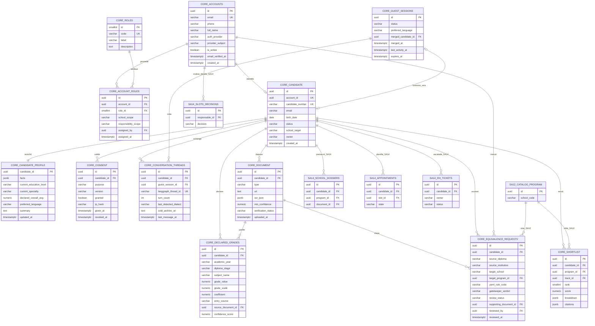

# SmartCampus AI — Modèle Relationnel `core` : Utilisateurs, Profils, Équivalences & Consentements (`SA-13`)

> **Tâche :** `[SA-13]` Concevoir les tables des utilisateurs, profils et candidatures (Issue GitHub `#8` · Story `SA-11 Modèle Relationnel`)  
> **Responsable :** Moataz Triki (`MT` / `@moatazz12`)  
> **Statut :** Spécification conceptuelle et schéma SQL de référence pour validation croisée avec `SA-12` et `SA-14` avant migration PostgreSQL (`SA-17`)

---

## 1. Principes de conception et périmètre `SA-13`

Ce document formalise le sous-modèle relationnel **`core`** dédié à l'identité des acteurs, au cycle de vie des candidats, au stockage multi-niveaux des conversations, aux profils académiques, aux notes déclarées, au consentement réglementaire et aux demandes d'équivalence, tout en définissant les **interfaces exactes** avec le catalogue académique (`SA-12`) et les modules préinscription / QCM / rendez-vous / entretiens (`SA-14`).

### Invariants architecturaux respectés
1. **Règle d'accès « Give or Keep » :** aucune donnée personnelle (PII) ni compte utilisateur n'est imposé en PostgreSQL durant la phase anonyme. La session chaude vit dans **Redis** (TTL 7 jours glissant) ; seule une trace technique sans PII (`core.guest_sessions`) sécurise la traçabilité et l'idempotence de la fusion au moment de la connexion.
2. **Séparation Déclaratif vs Officiel :** les notes déclarées durant l'orientation (`core.declared_grades` et `core.candidate_profile`) restent distinctes des documents officiels (`core.document`) déposés uniquement après authentification, afin de détecter automatiquement toute discordance (`declared ≠ official`) et d'ouvrir un ticket vers `Human RH`.
3. **Architecture mémoire 3 tiers :**
   * **Chaud (Redis) :** 6 à 8 derniers tours de conversation + état actif du graphe (TTL 7 jours).
   * **Tiède (PostgreSQL `core`) :** faits typés (`core.candidate_profile.facts`), synthèse glissante (`<= 300 tokens`), métadonnées et dernier checkpoint actif (`core.conversation_threads`).
   * **Froid (MinIO / S3) :** archives compressées `.jsonl.gz` référencées par `cold_archive_uri`.
4. **Conformité INPDP (Loi organique n° 2004-63) :** consentement explicite horodaté et versionné dans `core.consent` avant tout dépôt de relevé ou préinscription ; masquage des données personnelles dans `core.audit_log`.
5. **Gouvernance Human-in-the-Loop (HITL) & propriété unique (`One Owner`) :** `core.candidate.owner` garantit qu'un dossier est piloté soit par `JARVIS`, soit par un agent humain `RH:<account_id>`. Aucune décision d'admission ne réside dans les tables accessibles en écriture aux agents : les décisions signées exclusivement par `NAU_RESPONSABLE` sont isolées dans les schémas par école (`iit`, `isb`, `isa` — contrat `SA-14`).

---

## 2. Diagramme Entité-Association (Mermaid `erDiagram`)



---

## 3. Dictionnaire détaillé des tables (`core`)

### 3.1 Identité, rôles et acteurs (`accounts`, `roles`, `account_roles`, `guest_sessions`)

#### `core.accounts` — Comptes utilisateurs authentifiés
Regroupe l'ensemble des utilisateurs identifiés (candidats identifiés, `Human RH`, `NAU Responsable`, `Direction`, `Platform Admin`).

| Colonne | Type SQL | Contraintes | Description |
| :--- | :--- | :--- | :--- |
| `id` | `UUID` | `PRIMARY KEY DEFAULT gen_random_uuid()` | Identifiant technique unique du compte (claim JWT `sub`). |
| `email` | `VARCHAR(255)` | `NOT NULL UNIQUE` | Adresse email normalisée en minuscules (OTP / OAuth / notifications). |
| `phone` | `VARCHAR(32)` | `NULL` | Numéro de téléphone pour authentification OTP SMS et rappels `JARVIS`. |
| `full_name` | `VARCHAR(255)` | `NOT NULL` | Nom complet affiché dans les portails et fiches d'entretien. |
| `auth_provider` | `VARCHAR(32)` | `NOT NULL CHECK (auth_provider IN ('EMAIL_OTP', 'PHONE_OTP', 'GOOGLE_OAUTH', 'SSO'))` | Méthode d'authentification utilisée. |
| `provider_subject` | `VARCHAR(255)` | `NULL` | Identifiant externe OAuth/SSO (`UNIQUE (auth_provider, provider_subject)` si non null). |
| `department` | `VARCHAR(128)` | `NULL` | Service de rattachement pour le personnel (ex. `admissions`, `direction`). |
| `is_active` | `BOOLEAN` | `NOT NULL DEFAULT TRUE` | Permet la désactivation sans perte d'historique d'audit ou de décisions passées. |
| `email_verified_at` | `TIMESTAMPTZ` | `NULL` | Horodatage de vérification de l'adresse email. |
| `last_login_at` | `TIMESTAMPTZ` | `NULL` | Dernière connexion réussie. |
| `created_at` | `TIMESTAMPTZ` | `NOT NULL DEFAULT NOW()` | Date de création du compte. |
| `updated_at` | `TIMESTAMPTZ` | `NOT NULL DEFAULT NOW()` | Date de dernière mise à jour. |

#### `core.roles` — Référentiel des rôles RBAC
Les codes sont alignés avec les claims JWT `role` et la politique RBAC de l'API :

| `code` | `label` | Périmètre d'accès |
| :--- | :--- | :--- |
| `student` | Candidat identifié (`AUTHENTICATED_STUDENT`) | Propre dossier uniquement (RLS sur `candidate_id`). |
| `rh` | Responsable admissions & exceptions (`HUMAN_RH`) | Transversal IIT / ISB / ISA sur tickets RH et anomalies documentaires ; aucune signature d'admission. |
| `responsable` | Responsable NAU (`NAU_RESPONSABLE`) | Cloisonné par `school_scope` (RLS) ; publication créneaux, évaluation entretien, signature décision HITL. |
| `direction` | Direction générale NAU | Lecture seule sur tableaux de bord consolidés et requêtes analytiques `ATLAS`. |
| `admin` | Administrateur plateforme (`PLATFORM_ADMIN`) | Gestion RBAC, corpus RAG, règles YAML, banque QCM et modèles de notifications. |

#### `core.account_roles` — Affectation des rôles et cloisonnement par école
Permet le multi-rôle contrôlé et porte l'attribut `school_scope` exigé par les politiques Row-Level Security (RLS).

| Colonne | Type SQL | Contraintes | Description |
| :--- | :--- | :--- | :--- |
| `id` | `UUID` | `PRIMARY KEY DEFAULT gen_random_uuid()` | Clé primaire d'affectation. |
| `account_id` | `UUID` | `NOT NULL REFERENCES core.accounts(id) ON DELETE CASCADE` | Compte utilisateur rattaché. |
| `role_id` | `SMALLINT` | `NOT NULL REFERENCES core.roles(id) ON DELETE RESTRICT` | Rôle attribué. |
| `school_scope` | `core.school_code` | `NULL` (`'IIT' \| 'ISB' \| 'ISA'`) | Obligatoire pour le rôle `responsable`, `NULL` pour les rôles transversaux. |
| `responsibility_scope` | `VARCHAR(24)` | `NOT NULL DEFAULT 'ALL' CHECK (responsibility_scope IN ('ALL', 'ACADEMIC', 'INTERVIEW'))` | Permet de conserver le rôle `NAU Responsable` consolidé tout en autorisant une spécialisation académique / entretien si requise. |
| `assigned_by` | `UUID` | `NULL REFERENCES core.accounts(id)` | Administrateur ayant attribué le rôle. |
| `assigned_at` | `TIMESTAMPTZ` | `NOT NULL DEFAULT NOW()` | Horodatage d'attribution. |

Contrainte d'unicité fonctionnelle : index unique sur `(account_id, role_id, COALESCE(school_scope::text, 'GLOBAL'))`.

#### `core.guest_sessions` — Visiteurs sans compte (suivi sans PII et fusion idempotente)
Gère les visiteurs sans compte en conformité stricte avec le principe *« Give or Keep »* : le contenu conversationnel chaud reste dans Redis (TTL 7 jours), tandis que PostgreSQL trace uniquement l'identifiant technique de session pour fiabiliser et rendre idempotent l'appel `/auth/merge-session`.

| Colonne | Type SQL | Contraintes | Description |
| :--- | :--- | :--- | :--- |
| `id` | `UUID` | `PRIMARY KEY` | Identifiant issu du cookie signé / en-tête `X-Session-ID`. |
| `status` | `VARCHAR(16)` | `NOT NULL DEFAULT 'ACTIVE' CHECK (status IN ('ACTIVE', 'MERGED', 'EXPIRED'))` | État de la session visiteur. |
| `preferred_language` | `VARCHAR(24)` | `NULL CHECK (preferred_language IN ('FR', 'DERJA', 'ARABIZI'))` | Dernière langue / dialecte détecté pour reprise fluide. |
| `merged_candidate_id` | `UUID` | `NULL REFERENCES core.candidate(id) ON DELETE SET NULL` | Renseigné lors de l'authentification pour garantir la fusion unique. |
| `merged_at` | `TIMESTAMPTZ` | `NULL` | Date effective de fusion Redis → PostgreSQL. |
| `last_activity_at` | `TIMESTAMPTZ` | `NOT NULL DEFAULT NOW()` | Dernier échange anonyme enregistré. |
| `expires_at` | `TIMESTAMPTZ` | `NOT NULL` | Échéance TTL 7 jours glissants avant purge Redis. |
| `created_at` | `TIMESTAMPTZ` | `NOT NULL DEFAULT NOW()` | Ouverture de la session visiteur. |

---

### 3.2 Candidats, profils académiques, notes déclarées & consentement

#### `core.candidate` — Fiche candidat centrale (`candidate_status`)
Conserve le nom de table et les attributs pivots attendus par l'architecture cible et pilote tous les portails via `status` et `owner`.

| Colonne | Type SQL | Contraintes | Description |
| :--- | :--- | :--- | :--- |
| `id` | `UUID` | `PRIMARY KEY DEFAULT gen_random_uuid()` | Identifiant candidat (valeur transmise dans le claim JWT `candidate_id`). |
| `account_id` | `UUID` | `UNIQUE NULL REFERENCES core.accounts(id) ON DELETE RESTRICT` | Référence au compte authentifié (`NOT NULL` dès le statut `AUTHENTICATED`). |
| `candidate_number` | `VARCHAR(32)` | `NOT NULL UNIQUE` | Référence dossier lisible (ex. `NAU-2026-0042`). |
| `email` | `VARCHAR(255)` | `NOT NULL` | Email de contact (synchronisé avec `core.accounts.email` ; conservé pour compatibilité et recherche). |
| `birth_date` | `DATE` | `NULL` | Date de naissance pour détection de doublons (`email + nom + birth_date`). |
| `status` | `core.candidate_status` | `NOT NULL DEFAULT 'AUTHENTICATED'` | État unique du cycle de vie (`ANONYMOUS` … `ADMITTED \| WAITLIST \| REJECTED` + états transversaux). |
| `school_target` | `core.school_code` | `NULL` | École cible principale (`IIT`, `ISB` ou `ISA`), alimentée au choix de filière / préinscription. |
| `owner` | `VARCHAR(64)` | `NOT NULL DEFAULT 'JARVIS' CHECK (owner = 'JARVIS' OR owner LIKE 'RH:%')` | Propriétaire actif unique du dossier (`One Owner`). |
| `created_at` | `TIMESTAMPTZ` | `NOT NULL DEFAULT NOW()` | Date de création du dossier candidat. |
| `updated_at` | `TIMESTAMPTZ` | `NOT NULL DEFAULT NOW()` | Dernière mise à jour d'état ou de propriété. |

#### `core.candidate_profile` — Profil académique et synthèse tiède
| Colonne | Type SQL | Contraintes | Description |
| :--- | :--- | :--- | :--- |
| `candidate_id` | `UUID` | `PRIMARY KEY REFERENCES core.candidate(id) ON DELETE CASCADE` | Relation 1-1 avec le candidat. |
| `facts` | `JSONB` | `NOT NULL DEFAULT '{}'::jsonb` | Faits structurés extraits (`diplôme`, `centres_interet`, `ville`, `objectifs`, `contraintes`). |
| `current_education_level` | `VARCHAR(64)` | `NULL` | Niveau déclaré (`BAC`, `LICENCE`, `PREPA`, `MASTER`, `AUTRE`). |
| `current_specialty` | `VARCHAR(128)` | `NULL` | Spécialité / section d'origine déclarée (ex. `Mathématiques`, `Informatique`). |
| `declared_overall_avg` | `NUMERIC(5,2)` | `NULL CHECK (declared_overall_avg >= 0 AND declared_overall_avg <= 20)` | Moyenne générale déclarée avant dépôt du relevé officiel. |
| `preferred_language` | `VARCHAR(24)` | `NULL CHECK (preferred_language IN ('FR', 'DERJA', 'ARABIZI'))` | Langue de préférence pour le dialogue et les relances `JARVIS`. |
| `summary` | `TEXT` | `NOT NULL DEFAULT ''` | Résumé conversationnel glissant (`<= 300 tokens`), rafraîchi tous les 6 tours. |
| `updated_at` | `TIMESTAMPTZ` | `NOT NULL DEFAULT NOW()` | Dernière actualisation du profil ou du résumé. |

#### `core.declared_grades` — Notes par matière (déclarées vs confirmées VLM)
Permet d'évaluer finement l'éligibilité par matière (`1.3 Gatekeeper`) et de comparer objectivement les notes déclarées aux notes officielles extraites par `1.4 Reader`.

| Colonne | Type SQL | Contraintes | Description |
| :--- | :--- | :--- | :--- |
| `id` | `UUID` | `PRIMARY KEY DEFAULT gen_random_uuid()` | Clé primaire. |
| `candidate_id` | `UUID` | `NOT NULL REFERENCES core.candidate(id) ON DELETE CASCADE` | Candidat propriétaire de la note. |
| `academic_year` | `VARCHAR(16)` | `NULL` | Année universitaire ou session (ex. `2025-2026`). |
| `diploma_stage` | `VARCHAR(32)` | `NOT NULL CHECK (diploma_stage IN ('BAC', 'L1', 'L2', 'L3', 'PREPA_1', 'PREPA_2', 'M1', 'OTHER'))` | Niveau auquel se rapporte la note. |
| `subject_name` | `VARCHAR(128)` | `NOT NULL` | Intitulé de la matière (ex. `Mathématiques`, `Algorithmique`). |
| `grade_value` | `NUMERIC(5,2)` | `NOT NULL CHECK (grade_value >= 0 AND grade_value <= grade_scale)` | Note obtenue. |
| `grade_scale` | `NUMERIC(5,2)` | `NOT NULL DEFAULT 20.00 CHECK (grade_scale > 0)` | Barème maximal de notation. |
| `coefficient` | `NUMERIC(4,2)` | `NULL CHECK (coefficient > 0)` | Coefficient éventuel de la matière. |
| `entry_source` | `VARCHAR(24)` | `NOT NULL DEFAULT 'DECLARED_CHAT' CHECK (entry_source IN ('DECLARED_CHAT', 'CANDIDATE_FORM', 'VLM_CONFIRMED', 'RH_CORRECTED'))` | Origine de la donnée pour tracer l'audit `declared ≠ official`. |
| `source_document_id` | `UUID` | `NULL REFERENCES core.document(id) ON DELETE SET NULL` | Document officiel ayant confirmé la note après extraction VLM. |
| `confidence_score` | `NUMERIC(4,3)` | `NULL CHECK (confidence_score >= 0 AND confidence_score <= 1)` | Confiance retournée par le VLM lorsque `entry_source = 'VLM_CONFIRMED'`. |
| `created_at` | `TIMESTAMPTZ` | `NOT NULL DEFAULT NOW()` | Horodatage de création. |
| `updated_at` | `TIMESTAMPTZ` | `NOT NULL DEFAULT NOW()` | Horodatage de modification. |

#### `core.consent` — Enregistrement du consentement explicite (Loi n° 2004-63 / INPDP)
| Colonne | Type SQL | Contraintes | Description |
| :--- | :--- | :--- | :--- |
| `id` | `UUID` | `PRIMARY KEY DEFAULT gen_random_uuid()` | Identifiant unique de preuve de consentement. |
| `candidate_id` | `UUID` | `NOT NULL REFERENCES core.candidate(id) ON DELETE CASCADE` | Candidat ayant donné son consentement. |
| `purpose` | `VARCHAR(64)` | `NOT NULL CHECK (purpose IN ('ORIENTATION_PROFILE', 'DOCUMENT_OCR', 'ADMISSION_FOLLOWUP'))` | Finalité explicite et granulée du traitement. |
| `version` | `VARCHAR(32)` | `NOT NULL` | Version de la notice d'information acceptée (ex. `v1.0-2026`). |
| `granted` | `BOOLEAN` | `NOT NULL` | Accord positif explicite (`TRUE`) ou refus/retrait. |
| `ip_hash` | `VARCHAR(64)` | `NULL` | Empreinte SHA-256 anonymisée pour valeur probante sans stocker l'IP brute. |
| `given_at` | `TIMESTAMPTZ` | `NOT NULL DEFAULT NOW()` | Horodatage exact du consentement. |
| `revoked_at` | `TIMESTAMPTZ` | `NULL` | Date éventuelle d'exercice du droit de retrait. |

---

### 3.3 Conversations, documents officiels, shortlist, équivalences & événements

#### `core.conversation_threads` — Continuité conversationnelle et archive froide
| Colonne | Type SQL | Contraintes | Description |
| :--- | :--- | :--- | :--- |
| `id` | `UUID` | `PRIMARY KEY DEFAULT gen_random_uuid()` | Identifiant du fil de discussion. |
| `candidate_id` | `UUID` | `NULL REFERENCES core.candidate(id) ON DELETE CASCADE` | Renseigné après authentification / fusion. |
| `guest_session_id` | `UUID` | `NULL REFERENCES core.guest_sessions(id) ON DELETE SET NULL` | Référence d'origine lorsque le fil a commencé en mode visiteur. |
| `langgraph_thread_id` | `VARCHAR(128)` | `NOT NULL UNIQUE` | Clé de reprise du checkpointer LangGraph (dernier checkpoint conservé). |
| `turn_count` | `INTEGER` | `NOT NULL DEFAULT 0` | Nombre de tours (déclenche la mise à jour du résumé tous les 6 tours). |
| `last_detected_dialect` | `VARCHAR(24)` | `NULL CHECK (last_detected_dialect IN ('FR', 'DERJA', 'ARABIZI'))` | Langue/dialecte détecté par `1.1 Listener`. |
| `cold_archive_uri` | `TEXT` | `NULL` | Chemin MinIO (`s3://.../transcripts/<thread_id>.jsonl.gz`) pour archivage froid et évaluation. |
| `started_at` | `TIMESTAMPTZ` | `NOT NULL DEFAULT NOW()` | Ouverture de la conversation. |
| `last_message_at` | `TIMESTAMPTZ` | `NOT NULL DEFAULT NOW()` | Dernier message échangé. |

Contrainte d'intégrité : `CHECK (candidate_id IS NOT NULL OR guest_session_id IS NOT NULL)`.

#### `core.document` — Pièces justificatives et extraction VLM (`1.4 Reader`)
| Colonne | Type SQL | Contraintes | Description |
| :--- | :--- | :--- | :--- |
| `id` | `UUID` | `PRIMARY KEY DEFAULT gen_random_uuid()` | Identifiant du document. |
| `candidate_id` | `UUID` | `NOT NULL REFERENCES core.candidate(id) ON DELETE CASCADE` | Toujours rattaché à un candidat authentifié (jamais anonyme). |
| `type` | `VARCHAR(48)` | `NOT NULL CHECK (type IN ('RELEVE_BAC', 'RELEVE_UNIVERSITAIRE', 'DIPLOME', 'ATTESTATION_EQUIVALENCE', 'AUTRE'))` | Nature du justificatif. |
| `uri` | `TEXT` | `NOT NULL` | URI MinIO chiffrée du fichier original. |
| `ocr_json` | `JSONB` | `NULL` | JSON structuré produit par le VLM (`matières`, `notes`, `moyenne`, `confiance_par_champ`). |
| `min_confidence` | `NUMERIC(4,3)` | `NULL CHECK (min_confidence >= 0 AND min_confidence <= 1)` | Confiance minimale détectée ; déclenche le surlignage UI pour confirmation candidat. |
| `verification_status` | `VARCHAR(24)` | `NOT NULL DEFAULT 'PENDING' CHECK (verification_status IN ('PENDING', 'CONFIRMED_BY_STUDENT', 'MISMATCH_RH', 'VERIFIED'))` | État de validation du relevé. |
| `uploaded_at` | `TIMESTAMPTZ` | `NOT NULL DEFAULT NOW()` | Horodatage de dépôt. |

#### `core.shortlist` — Recommandations de parcours (`1.5 Advisor`)
| Colonne | Type SQL | Contraintes | Description |
| :--- | :--- | :--- | :--- |
| `id` | `UUID` | `PRIMARY KEY DEFAULT gen_random_uuid()` | Clé primaire. |
| `candidate_id` | `UUID` | `NOT NULL REFERENCES core.candidate(id) ON DELETE CASCADE` | Candidat orienté. |
| `program_id` | `UUID` | `NOT NULL` | Référence au programme dans le catalogue (`SA-12`). |
| `track_id` | `UUID` | `NULL` | Référence à la filière / spécialisation précise (`SA-12`). |
| `rank` | `SMALLINT` | `NOT NULL CHECK (rank BETWEEN 1 AND 5)` | Position dans la shortlist comparative (2–3 parcours recommandés). |
| `score` | `NUMERIC(5,2)` | `NOT NULL CHECK (score >= 0 AND score <= 100)` | Score issu de `score_compatibilite()` (critères académiques + intérêts uniquement). |
| `breakdown` | `JSONB` | `NOT NULL` | Détail pondéré du score affiché au candidat. |
| `citations` | `JSONB` | `NOT NULL DEFAULT '[]'::jsonb` | Sources officielles issues de `knowledge` (`pgvector`). |
| `created_at` | `TIMESTAMPTZ` | `NOT NULL DEFAULT NOW()` | Date de calcul de la recommandation. |

#### `core.equivalence_requests` — Demandes d'équivalence et passerelles
Modélise le traitement des demandes d'équivalence et des cas limites marqués *« à confirmer par le Responsable »* à l'étape 3 du pipeline.

| Colonne | Type SQL | Contraintes | Description |
| :--- | :--- | :--- | :--- |
| `id` | `UUID` | `PRIMARY KEY DEFAULT gen_random_uuid()` | Identifiant de la demande d'équivalence. |
| `candidate_id` | `UUID` | `NOT NULL REFERENCES core.candidate(id) ON DELETE CASCADE` | Candidat demandeur. |
| `source_diploma` | `VARCHAR(128)` | `NOT NULL` | Diplôme ou cursus déjà validé (ex. `Licence Informatique`, `2ème année Prépa`). |
| `source_institution` | `VARCHAR(192)` | `NULL` | Établissement d'origine. |
| `target_school` | `core.school_code` | `NOT NULL` | École ciblée (`IIT`, `ISB`, `ISA`). |
| `target_program_id` | `UUID` | `NOT NULL` | Programme cible visé par l'équivalence (catalogue `SA-12`). |
| `yaml_rule_code` | `VARCHAR(64)` | `NULL` | Identifiant de la règle YAML appliquée par `1.3 Gatekeeper`. |
| `gatekeeper_verdict` | `VARCHAR(32)` | `NOT NULL CHECK (gatekeeper_verdict IN ('ELIGIBLE', 'BORDERLINE_TO_CONFIRM', 'INELIGIBLE'))` | Pré-évaluation déterministe. |
| `review_status` | `VARCHAR(32)` | `NOT NULL DEFAULT 'PENDING_REVIEW' CHECK (review_status IN ('AUTO_VALIDATED', 'PENDING_REVIEW', 'APPROVED', 'REJECTED', 'NEEDS_MORE_INFO'))` | Décision humaine sur l'équivalence (jamais tranchée par un agent en cas limite). |
| `supporting_document_id` | `UUID` | `NULL REFERENCES core.document(id) ON DELETE SET NULL` | Justificatif associé après authentification. |
| `reviewed_by` | `UUID` | `NULL REFERENCES core.accounts(id)` | Compte `responsable` ou `rh` ayant instruit le cas. |
| `reviewer_comment` | `TEXT` | `NULL` | Justification académique / passerelle retenue. |
| `reviewed_at` | `TIMESTAMPTZ` | `NULL` | Horodatage de validation humaine. |
| `created_at` | `TIMESTAMPTZ` | `NOT NULL DEFAULT NOW()` | Création de la demande. |

#### `core.outbox` et `core.audit_log` — Découplage événementiel & traçabilité
* **`core.outbox`** (`id UUID PK`, `event_type VARCHAR(64) NOT NULL`, `aggregate_type VARCHAR(32) NOT NULL`, `aggregate_id UUID NOT NULL`, `payload JSONB NOT NULL`, `created_at TIMESTAMPTZ NOT NULL DEFAULT NOW()`, `processed_at TIMESTAMPTZ NULL`, `retry_count SMALLINT NOT NULL DEFAULT 0`) : assure le découplage strict entre `VISION` (soumission préinscription) et `JARVIS` (invitation/planification RDV), ainsi que le routage multi-écoles.
* **`core.audit_log`** (`id UUID PK`, `actor_type VARCHAR(24) NOT NULL`, `actor_id VARCHAR(64) NOT NULL`, `action VARCHAR(96) NOT NULL`, `entity_type VARCHAR(48) NOT NULL`, `entity_id UUID NULL`, `reason TEXT NULL`, `metadata JSONB NOT NULL DEFAULT '{}'::jsonb`, `created_at TIMESTAMPTZ NOT NULL DEFAULT NOW()`) : trace chaque changement d'état (*who / what / why*) sans PII en clair.

---

## 4. Script SQL de référence (`core` — volet `SA-13`)

Ce script DDL PostgreSQL 16 définit l'ordre de création, les clés étrangères, les index principaux et les contraintes prêts pour intégration dans les migrations Alembic/SQL (`SA-17`) :

```sql
CREATE EXTENSION IF NOT EXISTS pgcrypto;

CREATE SCHEMA IF NOT EXISTS core;
CREATE SCHEMA IF NOT EXISTS iit;
CREATE SCHEMA IF NOT EXISTS isb;
CREATE SCHEMA IF NOT EXISTS isa;
CREATE SCHEMA IF NOT EXISTS knowledge;

DO $$ BEGIN
    CREATE TYPE core.school_code AS ENUM ('IIT', 'ISB', 'ISA');
EXCEPTION
    WHEN duplicate_object THEN NULL;
END $$;

DO $$ BEGIN
    CREATE TYPE core.candidate_status AS ENUM (
        'ANONYMOUS', 'PROFILING', 'ELIGIBLE', 'INELIGIBLE', 'ORIENTED',
        'AUTHENTICATED', 'PREINSCRIBED', 'QCM_DONE', 'SCHEDULED', 'INTERVIEWED',
        'ADMITTED', 'WAITLIST', 'REJECTED',
        'DORMANT', 'ESCALATED', 'WITHDRAWN'
    );
EXCEPTION
    WHEN duplicate_object THEN NULL;
END $$;

CREATE TABLE IF NOT EXISTS core.accounts (
    id                UUID PRIMARY KEY DEFAULT gen_random_uuid(),
    email             VARCHAR(255) NOT NULL UNIQUE,
    phone             VARCHAR(32),
    full_name         VARCHAR(255) NOT NULL,
    auth_provider     VARCHAR(32)  NOT NULL CHECK (auth_provider IN ('EMAIL_OTP', 'PHONE_OTP', 'GOOGLE_OAUTH', 'SSO')),
    provider_subject  VARCHAR(255),
    department        VARCHAR(128),
    is_active         BOOLEAN      NOT NULL DEFAULT TRUE,
    email_verified_at TIMESTAMPTZ,
    last_login_at     TIMESTAMPTZ,
    created_at        TIMESTAMPTZ  NOT NULL DEFAULT NOW(),
    updated_at        TIMESTAMPTZ  NOT NULL DEFAULT NOW()
);

CREATE UNIQUE INDEX IF NOT EXISTS uq_accounts_provider_subject
    ON core.accounts (auth_provider, provider_subject)
    WHERE provider_subject IS NOT NULL;

CREATE TABLE IF NOT EXISTS core.roles (
    id          SMALLINT GENERATED ALWAYS AS IDENTITY PRIMARY KEY,
    code        VARCHAR(32)  NOT NULL UNIQUE CHECK (code IN ('student', 'rh', 'responsable', 'direction', 'admin')),
    label       VARCHAR(100) NOT NULL,
    description TEXT         NOT NULL
);

CREATE TABLE IF NOT EXISTS core.account_roles (
    id                   UUID PRIMARY KEY DEFAULT gen_random_uuid(),
    account_id           UUID             NOT NULL REFERENCES core.accounts(id) ON DELETE CASCADE,
    role_id              SMALLINT         NOT NULL REFERENCES core.roles(id) ON DELETE RESTRICT,
    school_scope         core.school_code,
    responsibility_scope VARCHAR(24)      NOT NULL DEFAULT 'ALL' CHECK (responsibility_scope IN ('ALL', 'ACADEMIC', 'INTERVIEW')),
    assigned_by          UUID             REFERENCES core.accounts(id),
    assigned_at          TIMESTAMPTZ      NOT NULL DEFAULT NOW()
);

CREATE UNIQUE INDEX IF NOT EXISTS uq_account_roles_scope
    ON core.account_roles (account_id, role_id, COALESCE(school_scope::text, 'GLOBAL'));

CREATE TABLE IF NOT EXISTS core.candidate (
    id               UUID PRIMARY KEY DEFAULT gen_random_uuid(),
    account_id       UUID                 UNIQUE REFERENCES core.accounts(id) ON DELETE RESTRICT,
    candidate_number VARCHAR(32)          NOT NULL UNIQUE,
    email            VARCHAR(255)         NOT NULL,
    birth_date       DATE,
    status           core.candidate_status NOT NULL DEFAULT 'AUTHENTICATED',
    school_target    core.school_code,
    owner            VARCHAR(64)          NOT NULL DEFAULT 'JARVIS' CHECK (owner = 'JARVIS' OR owner LIKE 'RH:%'),
    created_at       TIMESTAMPTZ          NOT NULL DEFAULT NOW(),
    updated_at       TIMESTAMPTZ          NOT NULL DEFAULT NOW()
);

CREATE INDEX IF NOT EXISTS idx_candidate_status_school ON core.candidate (status, school_target);
CREATE INDEX IF NOT EXISTS idx_candidate_email ON core.candidate (LOWER(email));

CREATE TABLE IF NOT EXISTS core.guest_sessions (
    id                  UUID PRIMARY KEY,
    status              VARCHAR(16) NOT NULL DEFAULT 'ACTIVE' CHECK (status IN ('ACTIVE', 'MERGED', 'EXPIRED')),
    preferred_language  VARCHAR(24) CHECK (preferred_language IN ('FR', 'DERJA', 'ARABIZI')),
    merged_candidate_id UUID        REFERENCES core.candidate(id) ON DELETE SET NULL,
    merged_at           TIMESTAMPTZ,
    last_activity_at    TIMESTAMPTZ NOT NULL DEFAULT NOW(),
    expires_at          TIMESTAMPTZ NOT NULL,
    created_at          TIMESTAMPTZ NOT NULL DEFAULT NOW()
);

CREATE TABLE IF NOT EXISTS core.candidate_profile (
    candidate_id            UUID PRIMARY KEY REFERENCES core.candidate(id) ON DELETE CASCADE,
    facts                   JSONB        NOT NULL DEFAULT '{}'::jsonb,
    current_education_level VARCHAR(64),
    current_specialty       VARCHAR(128),
    declared_overall_avg    NUMERIC(5,2) CHECK (declared_overall_avg >= 0 AND declared_overall_avg <= 20),
    preferred_language      VARCHAR(24)  CHECK (preferred_language IN ('FR', 'DERJA', 'ARABIZI')),
    summary                 TEXT         NOT NULL DEFAULT '',
    updated_at              TIMESTAMPTZ  NOT NULL DEFAULT NOW()
);

CREATE TABLE IF NOT EXISTS core.document (
    id                  UUID PRIMARY KEY DEFAULT gen_random_uuid(),
    candidate_id        UUID         NOT NULL REFERENCES core.candidate(id) ON DELETE CASCADE,
    type                VARCHAR(48)  NOT NULL CHECK (type IN ('RELEVE_BAC', 'RELEVE_UNIVERSITAIRE', 'DIPLOME', 'ATTESTATION_EQUIVALENCE', 'AUTRE')),
    uri                 TEXT         NOT NULL,
    ocr_json            JSONB,
    min_confidence      NUMERIC(4,3) CHECK (min_confidence >= 0 AND min_confidence <= 1),
    verification_status VARCHAR(24)  NOT NULL DEFAULT 'PENDING' CHECK (verification_status IN ('PENDING', 'CONFIRMED_BY_STUDENT', 'MISMATCH_RH', 'VERIFIED')),
    uploaded_at         TIMESTAMPTZ  NOT NULL DEFAULT NOW()
);

CREATE TABLE IF NOT EXISTS core.declared_grades (
    id                 UUID PRIMARY KEY DEFAULT gen_random_uuid(),
    candidate_id       UUID         NOT NULL REFERENCES core.candidate(id) ON DELETE CASCADE,
    academic_year      VARCHAR(16),
    diploma_stage      VARCHAR(32)  NOT NULL CHECK (diploma_stage IN ('BAC', 'L1', 'L2', 'L3', 'PREPA_1', 'PREPA_2', 'M1', 'OTHER')),
    subject_name       VARCHAR(128) NOT NULL,
    grade_value        NUMERIC(5,2) NOT NULL CHECK (grade_value >= 0 AND grade_value <= grade_scale),
    grade_scale        NUMERIC(5,2) NOT NULL DEFAULT 20.00 CHECK (grade_scale > 0),
    coefficient        NUMERIC(4,2) CHECK (coefficient > 0),
    entry_source       VARCHAR(24)  NOT NULL DEFAULT 'DECLARED_CHAT' CHECK (entry_source IN ('DECLARED_CHAT', 'CANDIDATE_FORM', 'VLM_CONFIRMED', 'RH_CORRECTED')),
    source_document_id UUID         REFERENCES core.document(id) ON DELETE SET NULL,
    confidence_score   NUMERIC(4,3) CHECK (confidence_score >= 0 AND confidence_score <= 1),
    created_at         TIMESTAMPTZ  NOT NULL DEFAULT NOW(),
    updated_at         TIMESTAMPTZ  NOT NULL DEFAULT NOW()
);

CREATE INDEX IF NOT EXISTS idx_declared_grades_candidate ON core.declared_grades (candidate_id, diploma_stage);

CREATE TABLE IF NOT EXISTS core.consent (
    id           UUID PRIMARY KEY DEFAULT gen_random_uuid(),
    candidate_id UUID        NOT NULL REFERENCES core.candidate(id) ON DELETE CASCADE,
    purpose      VARCHAR(64) NOT NULL CHECK (purpose IN ('ORIENTATION_PROFILE', 'DOCUMENT_OCR', 'ADMISSION_FOLLOWUP')),
    version      VARCHAR(32) NOT NULL,
    granted      BOOLEAN     NOT NULL,
    ip_hash      VARCHAR(64),
    given_at     TIMESTAMPTZ NOT NULL DEFAULT NOW(),
    revoked_at   TIMESTAMPTZ
);

CREATE INDEX IF NOT EXISTS idx_consent_candidate_purpose ON core.consent (candidate_id, purpose, given_at DESC);

CREATE TABLE IF NOT EXISTS core.conversation_threads (
    id                    UUID PRIMARY KEY DEFAULT gen_random_uuid(),
    candidate_id          UUID         REFERENCES core.candidate(id) ON DELETE CASCADE,
    guest_session_id      UUID         REFERENCES core.guest_sessions(id) ON DELETE SET NULL,
    langgraph_thread_id   VARCHAR(128) NOT NULL UNIQUE,
    turn_count            INTEGER      NOT NULL DEFAULT 0,
    last_detected_dialect VARCHAR(24)  CHECK (last_detected_dialect IN ('FR', 'DERJA', 'ARABIZI')),
    cold_archive_uri      TEXT,
    started_at            TIMESTAMPTZ  NOT NULL DEFAULT NOW(),
    last_message_at       TIMESTAMPTZ  NOT NULL DEFAULT NOW(),
    CHECK (candidate_id IS NOT NULL OR guest_session_id IS NOT NULL)
);

CREATE TABLE IF NOT EXISTS core.shortlist (
    id           UUID PRIMARY KEY DEFAULT gen_random_uuid(),
    candidate_id UUID         NOT NULL REFERENCES core.candidate(id) ON DELETE CASCADE,
    program_id   UUID         NOT NULL, -- FK vers catalogue SA-12 ajoutée en migration SA-17
    track_id     UUID,                  -- FK optionnelle vers parcours SA-12
    rank         SMALLINT     NOT NULL CHECK (rank BETWEEN 1 AND 5),
    score        NUMERIC(5,2) NOT NULL CHECK (score >= 0 AND score <= 100),
    breakdown    JSONB        NOT NULL,
    citations    JSONB        NOT NULL DEFAULT '[]'::jsonb,
    created_at   TIMESTAMPTZ  NOT NULL DEFAULT NOW()
);

CREATE UNIQUE INDEX IF NOT EXISTS uq_shortlist_candidate_program_track
    ON core.shortlist (candidate_id, program_id, COALESCE(track_id, '00000000-0000-0000-0000-000000000000'::uuid));

CREATE TABLE IF NOT EXISTS core.equivalence_requests (
    id                     UUID PRIMARY KEY DEFAULT gen_random_uuid(),
    candidate_id           UUID             NOT NULL REFERENCES core.candidate(id) ON DELETE CASCADE,
    source_diploma         VARCHAR(128)     NOT NULL,
    source_institution     VARCHAR(192),
    target_school          core.school_code NOT NULL,
    target_program_id      UUID             NOT NULL, -- FK vers catalogue SA-12 ajoutée en migration SA-17
    yaml_rule_code         VARCHAR(64),
    gatekeeper_verdict     VARCHAR(32)      NOT NULL CHECK (gatekeeper_verdict IN ('ELIGIBLE', 'BORDERLINE_TO_CONFIRM', 'INELIGIBLE')),
    review_status          VARCHAR(32)      NOT NULL DEFAULT 'PENDING_REVIEW' CHECK (review_status IN ('AUTO_VALIDATED', 'PENDING_REVIEW', 'APPROVED', 'REJECTED', 'NEEDS_MORE_INFO')),
    supporting_document_id UUID             REFERENCES core.document(id) ON DELETE SET NULL,
    reviewed_by            UUID             REFERENCES core.accounts(id),
    reviewer_comment       TEXT,
    reviewed_at            TIMESTAMPTZ,
    created_at             TIMESTAMPTZ      NOT NULL DEFAULT NOW()
);

CREATE TABLE IF NOT EXISTS core.outbox (
    id             UUID PRIMARY KEY DEFAULT gen_random_uuid(),
    event_type     VARCHAR(64) NOT NULL,
    aggregate_type VARCHAR(32) NOT NULL,
    aggregate_id   UUID        NOT NULL,
    payload        JSONB       NOT NULL,
    created_at     TIMESTAMPTZ NOT NULL DEFAULT NOW(),
    processed_at   TIMESTAMPTZ,
    retry_count    SMALLINT    NOT NULL DEFAULT 0
);

CREATE INDEX IF NOT EXISTS idx_outbox_unprocessed ON core.outbox (created_at) WHERE processed_at IS NULL;

CREATE TABLE IF NOT EXISTS core.audit_log (
    id          UUID PRIMARY KEY DEFAULT gen_random_uuid(),
    actor_type  VARCHAR(24) NOT NULL CHECK (actor_type IN ('STUDENT', 'RH', 'RESPONSABLE', 'DIRECTION', 'ADMIN', 'VISION', 'JARVIS', 'SYSTEM')),
    actor_id    VARCHAR(64) NOT NULL,
    action      VARCHAR(96) NOT NULL,
    entity_type VARCHAR(48) NOT NULL,
    entity_id   UUID,
    reason      TEXT,
    metadata    JSONB       NOT NULL DEFAULT '{}'::jsonb,
    created_at  TIMESTAMPTZ NOT NULL DEFAULT NOW()
);
```

---

## 5. Contrats d'interface et compatibilité (`SA-12`, `SA-14`, `SA-5`, `SA-17`)

Cette section garantit l'assemblage direct avec les lots parallèles du modèle relationnel et de la sécurité avant l'écriture des migrations `SA-17`.

### 5.1 Compatibilité avec `SA-12` (Catalogue académique IIT / ISB / ISA)
* **Références sortantes depuis `SA-13` :** `core.shortlist.program_id`, `core.shortlist.track_id`, `core.equivalence_requests.target_program_id` et `core.candidate.school_target` (`IIT | ISB | ISA`).
* **Contrat attendu côté `SA-12` :** les tables du catalogue (`programs`, `tracks`, `prerequisites`, `fees_deadlines`) doivent exposer une clé primaire `UUID` (`id`) et un attribut `school_code` compatible avec `core.school_code` (`IIT | ISB | ISA`).
* **Ordre de migration (`SA-17`) :** créer les tables catalogue `SA-12` avant d'activer les contraintes `FOREIGN KEY` de `core.shortlist` et `core.equivalence_requests`.

### 5.2 Compatibilité avec `SA-14` (Demandes de préinscription, QCM, rendez-vous et entretiens)
L'ensemble des tables portées par `SA-14` s'appuie directement sur les clés primaires de `SA-13` :

| Domaine couvert (`SA-14`) | Schéma | Table cible (`SA-14`) | Clés étrangères consommées depuis `SA-13` | Contraintes critiques |
| :--- | :--- | :--- | :--- | :--- |
| **Demandes de préinscription** | `iit` / `isb` / `isa` | `<school>.dossiers` | `candidate_id -> core.candidate(id)`<br/>`document_id -> core.document(id)`<br/>`program_id -> SA-12` | Écriture atomique `core + <school>` en une seule transaction + insertion `core.outbox`. |
| **QCM & Brief d'entretien** | `iit` / `isb` / `isa` | `<school>.qcm_results`, `<school>.briefs` | `candidate_id -> core.candidate(id)` via `dossier_id` | Isolation stricte par école (RLS). |
| **Résultats des entretiens (HITL)** | `iit` / `isb` / `isa` | `<school>.decisions` | `candidate_id -> core.candidate(id)`<br/>`decided_by -> core.accounts(id)` | Écriture **exclusivement** réservée au rôle `responsable` de l'école correspondante. |
| **Créneaux & Rendez-vous (`JARVIS`)** | `core` | `core.slot`, `core.appointment`, `core.appointment_event` | `slot.responsable_id -> core.accounts(id)`<br/>`appointment.candidate_id -> core.candidate(id)` | `UNIQUE (responsable_id, start_time)` + `SELECT ... FOR UPDATE` ; `reschedules <= 2`. |
| **Exceptions & Escalades RH** | `core` | `core.rh_ticket` | `candidate_id -> core.candidate(id)` | `owner` synchronisé avec `core.candidate.owner`. |

### 5.3 Compatibilité RBAC / RLS (`SA-5`) et Typage Frontend (`SA-8`)
* **Alignement RLS sur `core.candidate` :** la table `core.candidate` conserve sa clé primaire nommée `id` tandis que toutes ses tables dépendantes (`candidate_profile`, `declared_grades`, `consent`, `document`, `shortlist`, `equivalence_requests`, `dossiers`, `appointment`, `rh_ticket`) nomment leur clé étrangère `candidate_id`. Lors de `SA-17`, la politique RLS sur `core.candidate` doit donc utiliser :
  ```sql
  USING (id = current_setting('request.jwt.claim.candidate_id', true)::uuid)
  ```
  et `USING (candidate_id = current_setting('request.jwt.claim.candidate_id', true)::uuid)` sur les tables enfants.
* **Alignement rôles JWT & DB :** `core.roles.code` reprend exactement les valeurs attendues par les claims JWT (`student`, `rh`, `responsable`, `direction`, `admin`) et alimente la table de jonction `core.account_roles(school_scope)` nécessaire aux politiques RLS multi-écoles (`iit`, `isb`, `isa`).
* **Alignement Frontend (`SA-8`) :** l'énumération `core.candidate_status` correspond trait pour trait au type `CandidateStatus` (`ANONYMOUS` → `ADMITTED | WAITLIST | REJECTED` + `DORMANT`, `ESCALATED`, `WITHDRAWN`), `core.school_code` à `SchoolCode` (`IIT | ISB | ISA`), et `core.candidate.candidate_number` permet d'afficher la référence métier du dossier (`NAU-2026-XXXX`).
